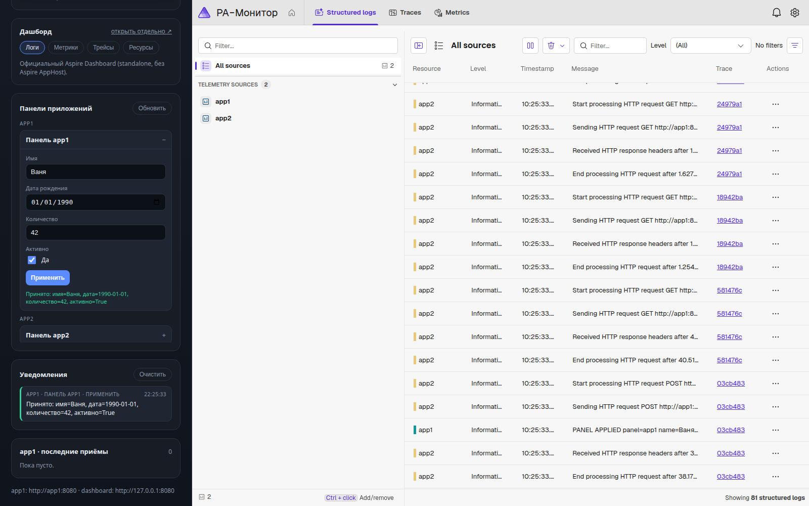
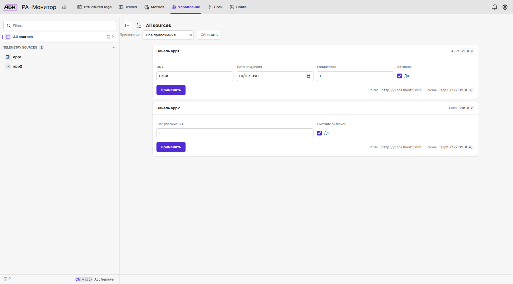

# РА-Монитор: Aspire Dashboard + свой контрол (без Aspire orchestration)

Минимальный пример на **.NET 10**:

- **app1** — Web API. Принимает `POST /api/messages`, пишет каждое полученное сообщение в лог и отдаёт свою интерактивную панель.
- **app2** — Web API + `BackgroundService`. Каждую секунду увеличивает счётчик, отдаёт его как метрику по OTLP, умеет отправить текущее значение в app1 и отдаёт свою панель.
- **Dashboard.Client** — SDK панелей + OpenTelemetry: атрибуты `[DashboardPanel]`, `[DashboardInput]`, `[DashboardAction]`, DI-регистрация, HTTP-эндпоинты `/dashboard/panels` и OTLP-настройка приложений.
- **aspire-dashboard** — официальный standalone Aspire Dashboard в контейнере. Показывает метрики, структурные логи и трейсы обоих приложений.
- **gateway** — nginx. Отдаёт дашборд и кастомную панель с одного origin, поэтому iframe дашборда не блокируется `X-Frame-Options`.
- **AppHost** (опционально, отдельно от compose) — тонкая оболочка Aspire только ради **нативной кнопки в официальном дашборде**. Основной сценарий полностью работает без Aspire.

> Шаг 1 «знакомство»: безопасность минимальная. Все порты опубликованы только на `127.0.0.1`, у дашборда отключён логин, между app1/app2 нет авторизации. Для продакшена это не годится — см. раздел «Безопасность».

## Две версии

В репозитории две независимые конфигурации на одних и тех же исходниках:

| Версия | Запуск | AppHost | Порты |
|---|---|---|---|
| Основная | `docker compose up -d --build` | опционально, для нативной кнопки | `8080`, `18888`, `4317` |
| **Standalone** | `cd standalone && docker compose up -d --build` | **нет** | `8090`, `18988`, `4327` |

Standalone-версия — это отдельный `standalone/compose.yaml`, `.env` и `OtelDemo.Standalone.slnx` **без проекта AppHost**. Панели `Dashboard.Client` в ней работают так же. Подробности: [`standalone/README.md`](standalone/README.md).

Обе версии можно запустить одновременно — порты не пересекаются.

## Быстрый старт

```bash
docker compose up -d --build
```

Откройте:

**http://localhost:8080/control** — панель управления со встроенным Aspire Dashboard.

Нажмите **«Отправить в app1»** или клавишу **Пробел**. В панели появится ответ app1, а в логах app1 — строка `MESSAGE RECEIVED`.

Ниже — блок **«Панели приложений»**: аккордеоны `app1` и `app2`, поля ввода и кнопка **«Применить»**. Значения уходят в тот app, которому принадлежит панель. Результат действия (`Task<string>`) появляется под кнопкой и в карточке **«Уведомления»**.



Полезные адреса:

| Адрес | Что это |
|---|---|
| http://localhost:8080/control | Кастомная панель + iframe Aspire Dashboard |
| http://localhost:8080/structuredlogs | Aspire Dashboard: логи |
| http://localhost:8080/traces | Aspire Dashboard: трейсы |
| http://localhost:8080/metrics | Aspire Dashboard: метрики |
| http://localhost:8080/management | **Управление: панели приложений** |
| http://localhost:18888 | Aspire Dashboard напрямую |
| http://localhost:8081 | app1 API |
| http://localhost:8082 | app2 API (и та же панель без iframe) |
| http://localhost:8081/dashboard/panels | панели app1 |
| http://localhost:8082/api/panels | агрегированные панели app1 + app2 |
| http://localhost:4317 | OTLP/gRPC для внешних приложений |

Остановить:

```bash
docker compose down
```

## Как это работает

```
Браузер
  │  http://localhost:8080/control
  ▼
nginx gateway (один origin)
  ├── /            → aspire-dashboard:18888   (UI, Blazor/WebSocket)
  ├── /control     → app2:8080                (кастомная панель)
  └── /app2/api/*  → app2:8080/api/*          (state/send/inbox)

app2 (каждую секунду +1)
  ├── OTLP/gRPC → aspire-dashboard:18889  (метрики app2.counter.*, логи, трейсы)
  └── POST /api/messages → app1:8080      (по кнопке/Пробелу, с текущим count)

app1
  ├── OTLP/gRPC → aspire-dashboard:18889  (метрики app1.messages.*, логи, трейсы)
  └── ILogger → stdout + OTLP             (строка MESSAGE RECEIVED ...)
```

### Метрики

| Метрика | Где | Что означает |
|---|---|---|
| `app2.counter.value` | app2 | Текущее значение счётчика (ObservableGauge) |
| `app2.counter.increments` | app2 | Количество тиков +1 (Counter) |
| `app2.messages.sent` | app2 | Сколько сообщений успешно отправлено в app1 |
| `app2.messages.sent.value` | app2 | Гистограмма отправленных значений |
| `app1.messages.received` | app1 | Сколько сообщений принято |
| `app1.messages.value` | app1 | Гистограмма принятых значений |

Метрики отправляются каждые 2 секунды (`OTEL_METRIC_EXPORT_INTERVAL=2000`), чтобы демо быстрее появлялось в дашборде.

### Логи

Логи собираются дважды:

1. **stdout контейнера** — обычный `docker compose logs`.
2. **OTLP → Aspire Dashboard** — через `builder.Logging.AddOpenTelemetry(...)` в `Dashboard.Client`.

Проверка:

```bash
# Лог app1 после нажатия кнопки
docker compose logs app1 | grep "MESSAGE RECEIVED"

# Структурные логи, которые реально дошли до дашборда
curl -s http://localhost:18888/api/telemetry/logs | python3 -m json.tool | head -60
```

## Dashboard.Client: SDK интерактивных панелей

`src/Dashboard.Client` — отдельная библиотека, которую подключают приложения. Она даёт:

- настройку OpenTelemetry (метрики, трейсы, логи → OTLP);
- атрибуты для описания панели, полей ввода и действий;
- DI-регистрацию панелей;
- HTTP-эндпоинты, через которые Dashboard читает панели и применяет действия;
- типовой контракт, по которому UI рисует аккордеон, inputs и кнопку «Применить».

### Как это выглядит в приложении

```csharp
using Dashboard.Client;

[DashboardPanel("Панель app1", order: 10)]
public sealed class App1DemoPanel(ILogger<App1DemoPanel> logger)
{
    [DashboardInput("Имя", sortOrder: 1)]
    public string Name { get; set; } = "";

    [DashboardInput("Дата рождения", DashboardInputType.Date, sortOrder: 2)]
    public DateOnly BirthDate { get; set; }

    [DashboardInput("Количество", DashboardInputType.Int, sortOrder: 3)]
    public int Count { get; set; }

    [DashboardInput("Активно", DashboardInputType.Bool, sortOrder: 4)]
    public bool Enabled { get; set; }

    // Необязательный Render: SDK вызывает его перед отдачей панели.
    public Task Render()
    {
        Name = "Ваня";
        BirthDate = new DateOnly(1990, 1, 1);
        Count = 1;
        Enabled = true;
        return Task.CompletedTask;
    }

    [DashboardAction("Применить")]
    public Task<string> Apply()
    {
        logger.LogInformation(
            "PANEL APPLIED name={Name} date={BirthDate} count={Count} enabled={Enabled}",
            Name, BirthDate, Count, Enabled);

        return Task.FromResult($"Принято: {Name}, {BirthDate:yyyy-MM-dd}, {Count}, {Enabled}");
    }
}
```

Подключение через DI в `Program.cs`:

```csharp
using Dashboard.Client;

builder.Services.AddDashboardPanel<App1DemoPanel>();
// или сканирование сборки:
// builder.Services.AddDashboardPanels(typeof(Program).Assembly);

var app = builder.Build();
app.MapDashboardPanels();
```

`AddDashboardPanel<T>()`:

- регистрирует панель singleton-ом в DI;
- добавляет её метаданные в `DashboardPanelRegistry`;
- панель может принимать зависимости через конструктор (`ILogger`, `CounterService`, `DbContext` и т.д.).

`MapDashboardPanels()` публикует:

| Метод | Путь | Назначение |
|---|---|---|
| `GET` | `/dashboard/panels` | список панелей приложения |
| `POST` | `/dashboard/panels/{panelId}/actions/{actionName}` | применить значения полей и вызвать action |

### Атрибуты

#### `[DashboardPanel]`

```csharp
[DashboardPanel("Панель app1", order: 10, Id = "app1-main")]
```

| Параметр | Значение |
|---|---|
| `title` | заголовок аккордеона |
| `order` | порядок панели |
| `Id` | стабильный id (по умолчанию имя класса) |
| `Description` | необязательное описание под заголовком |

#### `[DashboardInput]`

```csharp
[DashboardInput("Дата рождения", DashboardInputType.Date, sortOrder: 2)]
public DateOnly BirthDate { get; set; }
```

| Параметр | Значение |
|---|---|
| `label` | подпись поля |
| `type` | `Auto`, `Text`, `Date`, `Int`, `Number`, `Bool` |
| `sortOrder` | порядок поля |
| `Placeholder` | placeholder |
| `Required` | обязательное поле |

`Auto` выводит тип из CLR-типа:

| CLR | UI |
|---|---|
| `string` | `input type="text"` |
| `DateOnly`, `DateTime`, `DateTimeOffset` | `input type="date"` |
| `int`, `long`, `short` | `input type="number" step="1"` |
| `decimal`, `double`, `float` | `input type="number" step="any"` |
| `bool` | `checkbox` |

Поддерживаются `Nullable<T>`.

#### `[DashboardAction]`

```csharp
[DashboardAction("Применить", RequireConfirm = true)]
public Task Apply() { ... }
```

- метод должен быть public;
- без параметров или с одним `CancellationToken`;
- может возвращать `void`, `Task`, `Task<T>`, `ValueTask`, `ValueTask<T>`;
- если вернуть строку — она станет сообщением в UI;
- `RequireConfirm = true` — UI спросит подтверждение.

#### `Render` / `RenderAsync`

Необязательный метод без параметров (или с `CancellationToken`). Вызывается перед каждым `GET /dashboard/panels`, чтобы заполнить свойства программно.

После `Apply` SDK **не** вызывает `Render` повторно: в UI возвращается снимок свойств после действия. Поэтому введённые значения не затираются. При ручном «Обновить» панели `Render` снова заполнит значения.

### Как проходит нажатие «Применить»

```text
UI
 │  POST /api/panels/app1/App1DemoPanel/actions/Apply
 │  { "values": { "Name": "Маша", "BirthDate": "1995-12-31",
 │                "Count": 3, "Enabled": true } }
 ▼
app2 (dashboard host)
 │  проксирует в app1 через DI-клиент DashboardSourceRegistry
 ▼
app1
 │  POST /dashboard/panels/App1DemoPanel/actions/Apply
 │  SDK: values → свойства панели
 │  SDK: вызов App1DemoPanel.Apply()
 │  ответ: { success, message, panel: { ...новые значения... } }
 ▼
UI: обновляет поля, показывает message, статус ok/err
```

### Агрегация панелей из нескольких apps

Dashboard-хост (app2) умеет собирать панели из нескольких приложений.

Конфигурация:

```json
{
  "Dashboard": {
    "Sources": [
      { "Name": "app1", "Url": "http://app1:8080" }
    ]
  }
}
```

В compose:

```yaml
Dashboard__Sources__0__Name: app1
Dashboard__Sources__0__Url: http://app1:8080
```

`GET /api/panels` на app2 возвращает:

```json
{
  "sources": [
    { "name": "app1", "panels": [ ... ] },
    { "name": "app2", "panels": [ ... ] }
  ],
  "errors": []
}
```

Свои панели app2 добавляет всегда. Остальные источники опрашиваются через `DashboardSourceRegistry` — DI-singleton, который использует named `HttpClient` `dashboard-sources`. Ошибка одного источника не ломает остальные: она попадает в `errors`.

Добавить ещё один app:

1. Подключите в нём `Dashboard.Client`.
2. Зарегистрируйте панели и `MapDashboardPanels()`.
3. Добавьте источник в `Dashboard:Sources` (или env `Dashboard__Sources__1__Name/Url`).
4. Обновите панели в UI.

### Типовой UI-шаблон

UI не знает про конкретные классы. Он рисует то, что вернул `GET /api/panels`:

- источник → группа;
- панель → `<details>`-аккордеон;
- поле → `<input>` по `inputType`;
- действие → кнопка с `label`;
- ответ → сообщение под кнопкой.

Поэтому новую панель в app можно добавить без изменений в HTML Dashboard: достаточно класса с атрибутами и DI-регистрации.

### Ограничения шага 1

- Состояние панели живёт в памяти процесса (singleton). Рестарт app сбрасывает его.
- Общей БД нет: каждый app — владелец своих данных.
- Нет авторизации: `POST /dashboard/panels/...` может вызвать любой, кто достучался до app.
- Для production нужно закрыть `/dashboard/*` и `/api/panels/*` аутентификацией, добавить аудит действий и, при необходимости, persistence.

## Управление внутри Aspire Dashboard

Официальный standalone-образ Aspire Dashboard не поддерживает плагины. Поэтому в проекте собирается **свой образ дашборда** из исходников Aspire 17:

```text
dashboard/
  Dockerfile
  README.md
  aspire/                    # vendored Aspire 17.0.0 sources (dashboard)
    src/Aspire.Dashboard/...
```

Dockerfile:

1. берёт исходники из `dashboard/aspire` (vendored Aspire `v17.0.0`);
2. собирает `Aspire.Dashboard` без Native AOT;
3. собирает runtime-образ на `aspnet:11.0`.

Приложения остаются на **.NET 10**. .NET 11 используется только для сборки дашборда, потому что исходники Aspire 17 target `net11.0`.

### Что появляется в дашборде

В настоящей шапке Aspire Dashboard после вкладки **Metrics** появляется вкладка:

```text
Structured logs   Traces   Metrics   Управление
```

Логотип в шапке заменён на `dashboard/aspire/src/Aspire.Dashboard/wwwroot/img/logo-purple.png`.

Она ведёт на `/management` — страницу, которую отдаёт сам контейнер дашборда. Это не iframe и не app2 UI; контент рендерится внутри `resource-content`, как Traces/Metrics.

На странице:

- список зарегистрированных панелей из `GET /app2/api/panels`;
- фильтр **«Приложение»**: `Все приложения`, `app1`, `app2`, …;
- клик по `app1`/`app2` в левом списке ресурсов открывает `/management/resource/{app}` и сразу фильтрует панели;
- результат `Task<string>` и ошибки — в колокольчике Aspire Dashboard (Notification Center);
- заголовок панели показывает версию приложения из его assembly: `Панель app1 v1.0.0`;
- аккордеоны с элементами `text`, `date`, `int`, `bool`;
- кнопка **«Применить»** у каждой панели;
- результат `Task<string>` и ошибки в «Уведомлениях»;
- состояние фильтра в URL: `?app=app1`.



### Сборка и запуск

```bash
docker compose build aspire-dashboard
docker compose up -d
```

Или сразу:

```bash
docker compose up -d --build
```

Открыть:

```text
http://localhost:8080/management
```

Или через вкладку **Управление** в дашборде.

Важно: страница запрашивает `/app2/api/panels`, поэтому открывать её нужно через gateway (`:8080`, standalone — `:8090`). Прямой `:18888` отдаст страницу, но API app2 на этом origin нет.

### Как добавить панель

Ничего в дашборде менять не нужно:

1. добавьте класс с `[DashboardPanel]` / `[DashboardInput]` / `[DashboardAction]` в app;
2. зарегистрируйте его через `AddDashboardPanel<T>()`;
3. добавьте app в `Dashboard:Sources` (или это уже app1/app2);
4. нажмите «Обновить» на странице управления.

Фильтр по приложению строится из ответа `/api/panels`, поэтому новый app появится в списке автоматически.

## Файловый браузер: вкладки «Логи» и «Share»

После **«Управление»** в шапке дашборда появляются две вкладки:

```text
Structured logs   Traces   Metrics   Управление   Логи   Share
```

Вкладки опциональны: если путь для вкладки не задан, она не регистрируется и не показывается. Корни задаются через конфигурацию/DI:

```yaml
environment:
  Dashboard__Files__Logs__Path: /workspace/logs
  Dashboard__Files__Share__Path: /workspace/share
  Dashboard__Files__Logs__Title: Логи
  Dashboard__Files__Share__Title: Share
```

Проект смонтирован в дашборд read-only:

```yaml
volumes:
  - ./:/workspace:ro
  # Share — домашняя директория хоста
  - ${HOME}:/host-home:ro
```

Сейчас используются пути:

- `/workspace/logs` — логи текущего проекта;
- `/host-home` — домашняя директория хоста (read-only).

```dotenv
DASHBOARD_LOGS_PATH=/workspace/logs
DASHBOARD_SHARE_PATH=/host-home
```

### Что умеет

- поиск файлов и папок по маске: `*.log`, `*.txt;*.json`, `*`;
- папки показываются выше файлов, со своей иконкой;
- колонки: иконка, `Name`, `Size`, `Type`, `Date Modified`, `view`;
- переход в папку, `Вверх`, `В корень` (иконки + клавиша **Home**);
- скачивание файла: `/files/download?tab=logs&path=app1.log`;
- быстрый просмотр UTF-8 текста до 5 МБ в полноэкранном режиме;
- **подсветка JSON и YAML** через highlight.js;
- для текстового файла имя кликабельно и открывает просмотр;
- защита от выхода за пределы корневой директории;
- при переключении «Логи» ↔ «Share» контент перезагружается.

Адреса:

```text
http://localhost:8080/logs
http://localhost:8080/share
```

Скриншот: `docs/file-browser.png`.

> Скачивание сейчас без отдельной авторизации — это шаг 1. Для production закройте `/files/download` той же авторизацией, что и дашборд.

## Конфигурация

Все настройки — в `.env` (порты, адрес дашборда, образ). Значения по умолчанию:

```dotenv
COMPOSE_PROJECT_NAME=otel-demo
BIND_ADDR=127.0.0.1

GATEWAY_PORT=8080
DASHBOARD_PORT=18888
OTLP_PORT=4317
APP1_PORT=8081
APP2_PORT=8082
DASHBOARD_APP_NAME=РА-Монитор
DASHBOARD_SUPPRESS_UNSECURED=true

ASPIRE_DASHBOARD_IMAGE=mcr.microsoft.com/aspire/dashboard:17.0.0
```

Конфигурация приложений — обычные ASP.NET Core настройки + переменные окружения:

| Переменная | Сервис | Назначение |
|---|---|---|
| `App1__BaseUrl` | app2 | Куда отправлять сообщения (`http://app1:8080`) |
| `Dashboard__PublicUrl` | app2 | URL дашборда для ссылки в панели |
| `OTEL_EXPORTER_OTLP_ENDPOINT` | app1, app2 | OTLP endpoint (`http://aspire-dashboard:18889`) |
| `OTEL_METRIC_EXPORT_INTERVAL` | app1, app2 | Интервал экспорта метрик, мс |
| `ASPIRE_DASHBOARD_UNSECURED_ALLOW_ANONYMOUS` | dashboard | Отключает логин (только для локального демо) |
| `DASHBOARD_APP_NAME` | dashboard | Заголовок/имя приложения в дашборде (`РА-Монитор`) |
| `DASHBOARD_SUPPRESS_UNSECURED` | dashboard | Скрыть баннер «Endpoint is unsecured» (по умолчанию `true`) |
| `Dashboard__Otlp__SuppressUnsecuredMessage` | dashboard | Скрыть баннер «Endpoint is unsecured» |
| `Dashboard__Frontend__PublicUrl` | dashboard | Публичный URL дашборда за nginx |
| `Dashboard__Sources__N__Name` / `Url` | app2 | Приложения, чьи панели агрегировать |

Пример: поменять порт панели на `9090` — в `.env`:

```dotenv
GATEWAY_PORT=9090
```

и снова `docker compose up -d`. После этого панель: `http://localhost:9090/control`.

## Подробная настройка РА-Монитора

Этот раздел — про то, как устроен и настраивается именно монитор: имя, порты, вход, OTLP, лимиты, панель и iframe. Общая пошаговая сборка проекта — ниже, в разделе «Пошаговая настройка с нуля».

### 1. Из каких слоёв состоит монитор

```text
Браузер
  │  http://localhost:8080/control
  ▼
nginx gateway
  ├── /control      → статическая панель app2 (кнопка, счётчик, inbox)
  ├── /app2/api/*   → API app2 (state/send/inbox)
  └── /             → Aspire Dashboard 17 (логи, метрики, трейсы)

app1/app2 ── OTLP/gRPC ──→ aspire-dashboard:18889
```

Четыре независимых слоя настройки:

| Слой | Где | Что настраивает |
|---|---|---|
| Инфраструктура | `.env` | порты, bind-адрес, имя, версия образа |
| Проводка сервисов | `compose.yaml` | URL app1, OTLP endpoint, публичный URL дашборда |
| Приложение | `appsettings.json` + env | поведение app1/app2, уровни логов |
| Дашборд | env `ASPIRE_DASHBOARD_*`, `Dashboard__*` | auth, лимиты, persistence, OTLP |

Правило ASP.NET Core: `Section:Key` в JSON превращается в `Section__Key` в env. Например, `Dashboard:Frontend:PublicUrl` → `Dashboard__Frontend__PublicUrl`.

### 2. Имя и брендинг

Главный переключатель — в `.env`:

```dotenv
DASHBOARD_APP_NAME=РА-Монитор
```

Он передаётся в дашборд так:

```yaml
environment:
  ASPIRE_DASHBOARD_APPLICATION_NAME: "${DASHBOARD_APP_NAME:-РА-Монитор}"
```

Для standalone-дашборда (без resource service) это имя используется как **заголовок в шапке** и в `<title>` страниц: `РА-Монитор`, `РА-Монитор structured logs` и т.д.

Панель (`src/App2.Counter/wwwroot/index.html`) имеет собственные заголовки:

```html
<title>РА-Монитор · App2 → App1</title>
...
<h1>РА-Монитор</h1>
```

После изменения имени:

```bash
docker compose up -d --force-recreate aspire-dashboard
# если меняли HTML панели:
docker compose up -d --build app2
```

Проверка через Chrome DevTools MCP:

```js
// заголовок панели
document.title
// заголовок встроенного дашборда
document.getElementById('dashboard').contentDocument.title
```

Ожидаемо: `РА-Монитор · App2 → App1` и `РА-Монитор structured logs`.

> В дашборде остаётся служебный баннер «Welcome to the new Aspire dashboard!». Это уведомление самого дашборда, а не заголовок; его можно закрыть кнопкой «Don't ask again» (запоминается в localStorage браузера). Форк дашборда для его удаления не нужен.

### 3. Порты и сеть

Всё, что публикуется наружу, задаётся в `.env`:

```dotenv
BIND_ADDR=127.0.0.1

GATEWAY_PORT=8080      # единая точка входа: панель + дашборд
DASHBOARD_PORT=18888   # прямой доступ к дашборду
OTLP_PORT=4317         # OTLP/gRPC снаружи (внутри контейнера 18889)
APP1_PORT=8081
APP2_PORT=8082
```

Внутри compose используются DNS-имена, а не localhost:

```text
app2 → http://app1:8080
app1/app2 → http://aspire-dashboard:18889
gateway → http://aspire-dashboard:18888 и http://app2:8080
```

Важно не путать:

- **18888** — UI дашборда;
- **18889** — OTLP/gRPC внутри контейнера;
- **4317** — тот же OTLP, опубликованный на хосте;
- **18890** — OTLP/HTTP внутри контейнера (по умолчанию наружу не публикуется).

Поменять порт входа:

```dotenv
GATEWAY_PORT=9090
```

```bash
docker compose up -d
```

Монитор: `http://localhost:9090/control`. `Dashboard__Frontend__PublicUrl` в compose автоматически подхватит новый порт.

Если поставить `BIND_ADDR=0.0.0.0`, порты станут доступны всей сети. Для шага 1 это не рекомендуется: дашборд без пароля.

### 4. Публичный URL и reverse proxy

За обратным прокси дашборд должен знать, по какому адресу его открывает браузер:

```yaml
environment:
  Dashboard__Frontend__PublicUrl: "http://localhost:${GATEWAY_PORT:-8080}"
```

Если этого не сделать, redirect после логина и абсолютные ссылки могут уйти на внутренний адрес/неправильный порт.

В `deploy/nginx.conf` критичны три вещи:

```nginx
proxy_set_header Host $http_host;   # сохраняет :8080
proxy_http_version 1.1;
proxy_set_header Upgrade $http_upgrade;
proxy_set_header Connection $connection_upgrade;  # Blazor WebSocket
```

Использовать `$host` вместо `$http_host` нельзя: теряется порт.

Дашборд отдаёт:

```text
X-Frame-Options: SAMEORIGIN
Content-Security-Policy: frame-ancestors 'self'
```

Поэтому iframe работает только с того же origin. У нас это обеспечивает nginx: панель `/control` и дашборд `/` — один `http://localhost:8080`.

Если открыть app2 напрямую (`http://localhost:8082`) и попытаться встроить `http://localhost:18888`, браузер заблокирует iframe. Панель это учитывает и показывает ссылку «открыть отдельно».

Свой домен/прокси:

1. Поставьте `Dashboard__Frontend__PublicUrl=https://monitor.example.com`.
2. Проксируйте `/` на `aspire-dashboard:18888`, `/control` и `/app2/` на `app2:8080`.
3. Включите WebSocket/Upgrade.
4. Для HTTPS-терминации на прокси включите forwarded headers у дашборда: `ASPNETCORE_FORWARDEDHEADERS_ENABLED=true`.

Встраивание дашборда в **подпуть** (`/aspire/`) без переписывания абсолютных путей не поддерживается: SPA/Blazor использует `/`, `/api/...`, `/css/...` от корня. Надёжнее отдельный поддомен или отдельный порт.

### 5. Вход и безопасность дашборда

Шаг 1 (сейчас):

```yaml
ASPIRE_DASHBOARD_UNSECURED_ALLOW_ANONYMOUS: "true"
```

Это отключает логин и переводит Frontend/OTLP/API в `Unsecured`. Допустимо только на loopback.

Шаг 2 — вернуть логин:

1. Удалите/поставьте `false` для `ASPIRE_DASHBOARD_UNSECURED_ALLOW_ANONYMOUS`.
2. Пересоздайте контейнер:

```bash
docker compose up -d --force-recreate aspire-dashboard
docker compose logs aspire-dashboard | grep 'login?t='
```

3. Откройте ссылку вида `http://localhost:18888/login?t=...` (замените хост на `localhost`).

Можно задать фиксированный browser token:

```yaml
environment:
  Dashboard__Frontend__BrowserToken: "change-me-long-random-token"
```

Закрыть OTLP API-ключом:

```yaml
environment:
  Dashboard__Otlp__AuthMode: ApiKey
  Dashboard__Otlp__PrimaryApiKey: "otlp-secret"
```

Тогда приложениям нужно отправлять заголовок `x-otlp-api-key`. В текущем `Dashboard.Client` endpoint задаётся кодом; для API-ключа добавьте в `ConfigureOtlp`:

```csharp
options.Headers = builder.Configuration["OTEL_EXPORTER_OTLP_HEADERS"];
```

и передавайте в compose:

```yaml
OTEL_EXPORTER_OTLP_HEADERS: "x-otlp-api-key=otlp-secret"
```

Закрыть HTTP API дашборда:

```yaml
environment:
  Dashboard__Api__AuthMode: ApiKey
  Dashboard__Api__PrimaryApiKey: "api-secret"
```

```bash
curl -H 'X-API-Key: api-secret' http://localhost:18888/api/telemetry/logs
```

Для production также нужны HTTPS, ограничение доступа к OTLP-порту, аутентификация app1 и rate limiting. Дашборд — dev-инструмент, не production monitoring.

### 6. Как приложения попадают в монитор (OTLP)

Общая переменная для обоих приложений:

```yaml
OTEL_EXPORTER_OTLP_ENDPOINT: http://aspire-dashboard:18889
```

В коде:

```csharp
var endpoint = builder.Configuration["OTEL_EXPORTER_OTLP_ENDPOINT"]
               ?? "http://localhost:4317";
...
options.Endpoint = new Uri(endpoint);
options.Protocol = OtlpExportProtocol.Grpc;
```

`service.name` задаётся ресурсом:

```csharp
ResourceBuilder.CreateDefault()
    .AddService("app2", serviceVersion: "1.0.0");
```

Именно по `service.name` дашборд группирует источники `app1`/`app2`.

Добавить третье приложение:

1. Добавьте проект и `Dashboard.Client`.
2. В `Program.cs`: `builder.AddDemoObservability("app3", "OtelDemo.App3");`.
3. В compose: `OTEL_EXPORTER_OTLP_ENDPOINT=http://aspire-dashboard:18889`.
4. При необходимости добавьте метры: `AddMeter("OtelDemo.App3")`.
5. Перезапустите compose — источник появится в дашборде автоматически.

Интервалы экспорта:

```yaml
OTEL_METRIC_EXPORT_INTERVAL: "2000"  # метрики, мс
OTEL_BSP_SCHEDULE_DELAY: "1000"      # логи/трейсы, мс
```

Пока не прошёл первый экспорт, у ресурса может быть `hasMetrics: false`. Это нормально.

Если нужен OTLP/HTTP вместо gRPC:

1. Опубликуйте порт `18890` (сейчас только внутри).
2. В приложении задайте `OTEL_EXPORTER_OTLP_PROTOCOL=http/protobuf` и endpoint `http://aspire-dashboard:18890`.

### 7. Метрики

Метрики app2 объявлены в `CounterService`:

```csharp
meter.CreateCounter<long>("app2.counter.increments", unit: "{tick}");
meter.CreateCounter<long>("app2.messages.sent", unit: "{message}");
meter.CreateHistogram<long>("app2.messages.sent.value", unit: "{count}");
meter.CreateObservableGauge("app2.counter.value", () => Count, unit: "{count}");
```

Правила, которые стоит соблюдать:

- имя — `<сервис>.<сущность>.<действие>` (`app2.counter.value`);
- единица измерения — в `unit`;
- не делать gauge для монотонного счётчика, если нужна сумма — используйте Counter;
- значения-размеры/задержки — Histogram;
- теги (`KeyValuePair<string, object?>`) добавляйте только с низкой кардинальностью.

Добавить новую метрику:

```csharp
private readonly Counter<long> _errors;

// в конструкторе
_errors = meter.CreateCounter<long>("app2.send.errors", unit: "{error}");

// при ошибке
_errors.Add(1, new KeyValuePair<string, object?>("reason", "timeout"));
```

Метрики появятся на странице **Metrics** после выбора источника `app2` и метра `OtelDemo.App2`. В Aspire Dashboard 17 HTTP API метрик нет (`/api/telemetry/metrics` → 404), поэтому проверка — через UI/MCP.

Лимит хранения точек:

```yaml
environment:
  Dashboard__TelemetryLimits__MaxMetricsCount: "50000"
```

### 8. Логи

Логи включены в `Dashboard.Client`:

```csharp
builder.Logging.AddOpenTelemetry(logging =>
{
    logging.SetResourceBuilder(resource);
    logging.IncludeFormattedMessage = true;
    logging.IncludeScopes = true;
    logging.AddOtlpExporter(...);
});
```

При этом стандартный console-provider остаётся, поэтому лог есть в двух местах:

- `docker compose logs app1` — stdout;
- **Structured logs** в дашборде — OTLP.

Структурные параметры становятся полями:

```csharp
logger.LogInformation(
    "MESSAGE RECEIVED id={MessageId} count={Count} source={Source}",
    message.Id, message.Count, message.Source);
```

В дашборде будут поля `MessageId`, `Count`, `Source`.

Уровни логов:

```yaml
environment:
  Logging__LogLevel__Default: Information
  Logging__LogLevel__Microsoft.AspNetCore: Warning
```

Уменьшить объём: в `CounterService` лог тика сейчас раз в 10 секунд:

```csharp
if (value % 10 == 0)
{
    _logger.LogInformation("COUNTER TICK value={Count}", value);
}
```

Запрос логов через API:

```bash
curl 'http://localhost:18888/api/telemetry/logs?limit=50'
curl 'http://localhost:18888/api/telemetry/logs?severity=Warning&limit=20'
```

Лимит:

```yaml
Dashboard__TelemetryLimits__MaxLogCount: "100000"
```

### 9. Трейсы

Трейсы уже включены:

```csharp
tracing.AddAspNetCoreInstrumentation()
       .AddHttpClientInstrumentation();
```

Поэтому цепочка `app2 → POST app1` видна как распределённый трейс, а `traceId` связывает логи.

Проверка:

```bash
curl 'http://localhost:18888/api/telemetry/traces?limit=5'
```

Сэмплирование — стандартной переменной OTel:

```yaml
OTEL_TRACES_SAMPLER: parentbased_always_on
```

Для своих `ActivitySource` добавьте его в tracer provider:

```csharp
tracing.AddSource("My.App");
```

### 10. Настройка UI панели

Панель — это обычная статическая страница `src/App2.Counter/wwwroot/index.html`, которую отдаёт app2. Никакого React/Blazor и сборки фронтенда нет: HTML + CSS + vanilla JS. Это сделано специально, чтобы панель можно было менять без отдельного frontend-тулчейна.

#### 10.1. Из чего состоит панель

```text
index.html
  ├── <aside> — левая колонка
  │     ├── заголовок РА-Монитор
  │     ├── карточка счётчика app2 + кнопка отправки
  │     ├── карточка дашборда + вкладки Логи/Метрики/Трейсы/Ресурсы
  │     └── карточка «app1 · последние приёмы»
  └── <main> — iframe с официальным Aspire Dashboard
```

Источники данных:

| Элемент UI | Запрос | Что получает |
|---|---|---|
| Большой счётчик | `GET /api/state` | `count`, `lastSentCount`, `lastSentAt` |
| Список приёмов | `GET /api/inbox` | прокси к `app1/api/messages` |
| Кнопка/Пробел | `POST /api/send` | отправка текущего count в app1 |
| Ссылки/iframe | `GET /api/config` | `app1BaseUrl`, `dashboardPublicUrl` |

Файлы, которые участвуют в UI:

| Файл | Роль |
|---|---|
| `src/App2.Counter/wwwroot/index.html` | вся панель: разметка, стили, JS |
| `src/App2.Counter/Program.cs` | API панели (`/api/state`, `/api/send`, `/api/inbox`, `/api/config`) |
| `src/App2.Counter/appsettings.json` | `App1:BaseUrl`, `Dashboard:PublicUrl` |
| `deploy/nginx.conf` | маршруты `/control` и `/app2/api/*` |
| `compose.yaml` | `App1__BaseUrl`, `Dashboard__PublicUrl`, порты |

#### 10.2. Главный блок настроек

В начале `<script>` есть объект `UI`. Это единственное место, где меняются основные параметры поведения:

```javascript
const UI = {
    hotkey: 'Space',              // KeyboardEvent.code: 'Space', 'Enter', 'KeyS'
    statePollMs: 500,             // обновление счётчика, мс
    inboxPollMs: 2000,            // обновление списка app1, мс
    iframeBindMs: 1000,           // проверка готовности iframe к клавишам
    startPage: 'structuredlogs',  // стартовая страница дашборда
    inboxLimit: 8                 // сколько сообщений показывать
};
```

| Параметр | Допустимые значения | Эффект |
|---|---|---|
| `hotkey` | `Space`, `Enter`, `KeyS`, `F2`… | какая клавиша отправляет count |
| `statePollMs` | 100–10000 | чаще = плавнее счётчик, больше запросов |
| `inboxPollMs` | 500–30000 | частота обновления списка app1 |
| `iframeBindMs` | 500–5000 | как быстро клавиша начинает работать внутри iframe |
| `startPage` | `structuredlogs`, `metrics`, `traces`, `resources` | что открыто при загрузке |
| `inboxLimit` | 1–50 | сколько последних сообщений рендерить |
| `notificationLimit` | 1–100 | сколько уведомлений хранить в панели |

Важно: `hotkey` — это `KeyboardEvent.code`, а не символ. Для Enter — `'Enter'`, для пробела — `'Space'`, для латинской S — `'KeyS'`.

#### 10.3. Заголовок и тексты

```html
<title>РА-Монитор · App2 → App1</title>
...
<h1>РА-Монитор</h1>
...
<button class="send" id="send" type="button">
    Отправить в app1 <span style="opacity:.75">(Пробел)</span>
</button>
```

Меняйте:

- `<title>` — заголовок вкладки браузера;
- `<h1>` — заголовок панели;
- текст кнопки — подпись действия;
- `(Пробел)` — подсказку, если поменяли `UI.hotkey`;
- `aria-label`/`title` у iframe — для доступности.

Если меняете `hotkey`, обновите и подпись кнопки, иначе пользователь будет видеть старую подсказку.

#### 10.4. Тема и CSS

Все цвета вынесены в CSS-переменные в `:root`:

```css
:root {
    --bg: #0f1218;
    --panel: #171c25;
    --panel-2: #1f2632;
    --border: #2a3342;
    --text: #e7ecf3;
    --muted: #8b98ab;
    --accent: #5b8cff;
    --accent-2: #38d39f;
    --danger: #ff6b6b;
}
```

| Переменная | За что отвечает |
|---|---|
| `--bg` | фон страницы |
| `--panel` | фон карточек |
| `--panel-2` | фон элементов внутри карточек |
| `--border` | рамки |
| `--text` | основной текст |
| `--muted` | вторичный текст |
| `--accent` | кнопки, активные вкладки, ссылки |
| `--accent-2` | счётчик, успешный статус |
| `--danger` | ошибки |

Пример «светлой» темы:

```css
:root {
    --bg: #f5f7fb;
    --panel: #ffffff;
    --panel-2: #eef2f8;
    --border: #d8e0ec;
    --text: #162033;
    --muted: #5f6f86;
    --accent: #2563eb;
    --accent-2: #059669;
    --danger: #dc2626;
}
```

Ширина левой колонки:

```css
body {
    grid-template-columns: 380px minmax(0, 1fr);
}
```

Адаптивность: при ширине меньше `980px` панель складывается в одну колонку (`@media (max-width: 980px)`).

#### 10.5. Что делает JS

| Функция | Назначение |
|---|---|
| `setStatus(text, kind)` | пишет текст в блок статуса (`ok`/`err`) |
| `getJson(url, options)` | fetch + разбор JSON + понятная ошибка |
| `formatTime(value)` | время в локальном формате |
| `escapeHtml(value)` | экранирование перед вставкой в HTML |
| `renderInbox(messages)` | рисует последние сообщения app1 |
| `refreshState()` | обновляет счётчик и «последнюю отправку» |
| `refreshInbox()` | обновляет список принятых сообщений |
| `sendCounter()` | POST `/api/send`, блокирует кнопку на время запроса |
| `selectTab(page)` | переключает iframe на страницу дашборда |
| `handleShortcut(event)` | обработка клавиши |
| `bindIframeKeyboard()` | пробрасывает клавишу внутрь iframe |
| `init()` | первичная загрузка конфига, обработчиков и интервалов |

`sendCounter()` защищён от двойного клика (`busy`), блокирует кнопку на время запроса и всегда снимает блокировку в `finally`.

#### 10.6. Добавить свою кнопку и команду

Пример: кнопка «Проверить app1».

**1. Endpoint в app2** (`Program.cs`):

```csharp
app.MapGet("/api/ping-app1", async (IHttpClientFactory httpClientFactory, CancellationToken ct) =>
{
    var client = httpClientFactory.CreateClient("app1");
    try
    {
        var body = await client.GetStringAsync("/healthz", ct);
        return Results.Ok(new { ok = true, response = body });
    }
    catch (Exception ex)
    {
        return Results.Problem(ex.Message);
    }
});
```

**2. Кнопка в HTML** (рядом с существующей):

```html
<button class="send" id="ping" type="button"
        style="background:linear-gradient(180deg,#38d39f,#22b884)">
    Проверить app1
</button>
```

**3. Обработчик в JS**:

```javascript
async function pingApp1() {
    setStatus('Проверяю app1…');
    try {
        const result = await getJson(`${apiBase}/ping-app1`);
        setStatus(`app1 ответил: ${result.response}`, 'ok');
    } catch (error) {
        setStatus(`app1 недоступен: ${error.message}`, 'err');
    }
}

document.getElementById('ping').addEventListener('click', pingApp1);
```

Добавьте этот код в `init()` после существующих обработчиков.

#### 10.7. Добавить форму ввода

HTML:

```html
<div class="card">
    <strong style="font-size:13px">Заметка в app1</strong>
    <input id="note-text" type="text" placeholder="Текст сообщения"
           style="width:100%;margin-top:10px;padding:9px;border-radius:8px;
                  border:1px solid var(--border);background:var(--panel-2);color:var(--text)" />
    <button class="send" id="note-send" type="button">Отправить заметку</button>
</div>
```

Endpoint в app2 (пример без внешних зависимостей):

```csharp
app.MapPost("/api/note", (NoteRequest request, ILogger<Program> logger) =>
{
    logger.LogInformation("NOTE RECEIVED text={Text}", request.Text);
    return Results.Ok(new { saved = request.Text });
});

internal sealed record NoteRequest(string Text);
```

JS:

```javascript
async function sendNote() {
    const input = document.getElementById('note-text');
    const text = input.value.trim();
    if (!text) return;

    try {
        const result = await getJson(`${apiBase}/note`, {
            method: 'POST',
            headers: { 'Content-Type': 'application/json' },
            body: JSON.stringify({ text })
        });
        setStatus(`Сохранено: ${result.saved}`, 'ok');
        input.value = '';
    } catch (error) {
        setStatus(`Ошибка: ${error.message}`, 'err');
    }
}

document.getElementById('note-send').addEventListener('click', sendNote);
```

Форма с секретами/токенами должна отправляться на app2, а не хранить секрет в JS: статический файл видят все.

#### 10.8. Добавить вкладку дашборда

Сейчас вкладки — это просто кнопки с `data-page`:

```html
<button class="tab active" data-page="structuredlogs">Логи</button>
<button class="tab" data-page="metrics">Метрики</button>
<button class="tab" data-page="traces">Трейсы</button>
<button class="tab" data-page="resources">Ресурсы</button>
```

`selectTab(page)` делает:

```javascript
el.dashboard.src = gatewayMode
    ? `/${page}`
    : `${config.dashboardPublicUrl}/${page}`;
```

Чтобы добавить свою страницу дашборда, достаточно добавить кнопку с новым `data-page`, если такой маршрут есть в дашборде. Для произвольного URL (например, свой отчёт) можно расширить `selectTab`:

```javascript
const externalPages = {
    report: '/app2/report'
};

function selectTab(page) {
    const url = externalPages[page] ?? (gatewayMode ? `/${page}` : `${config.dashboardPublicUrl}/${page}`);
    el.dashboard.src = url;
    ...
}
```

Помните: iframe с другим origin может быть заблокирован `X-Frame-Options`/CSP.

#### 10.9. Клавиша и фокус

`handleShortcut`:

```javascript
if (event.code !== UI.hotkey || event.repeat) return;
if (isTypingTarget(event.target)) return;
event.preventDefault();
sendCounter();
```

`isTypingTarget` не перехватывает клавишу в:

- `INPUT`, `TEXTAREA`, `SELECT`;
- `BUTTON`, `A`;
- `contenteditable`.

Поэтому в полях поиска дашборда пробел работает как обычно.

Клавиша внутри iframe:

```javascript
function bindIframeKeyboard() {
    const doc = el.dashboard.contentDocument;
    if (!doc || doc.__otelDemoShortcutBound) return;
    doc.__otelDemoShortcutBound = true;
    doc.addEventListener('keydown', handleShortcut, true);
}
```

Это возможно только потому, что панель и дашборд same-origin через nginx. При прямом открытии app2 на `:8082` доступ к `contentDocument` другого origin запрещён — остаётся кнопка и клавиша при фокусе на самой панели.

#### 10.10. Gateway-режим и прямой режим

```javascript
const gatewayMode = window.location.pathname.startsWith('/control');
const apiBase = gatewayMode ? '/app2/api' : '/api';
```

| Режим | URL | API | iframe |
|---|---|---|---|
| Gateway | `http://localhost:8080/control` | `/app2/api/*` | `/structuredlogs` — same-origin, работает |
| Напрямую | `http://localhost:8082/` | `/api/*` | `http://localhost:18888/...` — cross-origin, блокируется |

Прямой режим удобен для отладки API, но для полноценного UI используйте `/control`.

Если панель и API окажутся на разных origin, включите CORS в app2 и передавайте credentials при необходимости. Сейчас это не требуется: nginx сводит всё в один origin.

#### 10.11. Ошибки, статусы и доступность

- Все сообщения пишутся в `#status` через `textContent`, а не `innerHTML`.
- У статуса есть `role="status"` и `aria-live="polite"` — скринридер озвучивает результат.
- Кнопка блокируется на время запроса, повторный клик игнорируется.
- Ошибки app1 показываются как `HTTP 500 ...` или `app1 is not reachable`.
- Данные из app1 вставляются в HTML только через `escapeHtml`.

Если добавляете новый блок с динамическими данными, не используйте `innerHTML` без экранирования. Для простого текста используйте `textContent`.

#### 10.12. Сборка и проверка изменений UI

После правки `index.html`:

```bash
docker compose up -d --build app2
```

Почему нужен `--build`: файл копируется в Docker-образ на этапе `COPY src/ src/`. Без пересборки контейнер продолжит отдавать старую версию.

Проверка:

```bash
curl -s http://localhost:8080/control | grep -o '<h1>[^<]*</h1>'
# <h1>РА-Монитор</h1>

curl -s http://localhost:8080/app2/api/config
```

Проверка через Chrome DevTools MCP:

```js
// открыть http://localhost:8080/control
document.title
document.querySelector('h1').textContent
document.getElementById('counter').textContent
document.getElementById('dashboard').contentDocument.title
```

Проверка клавиши:

```js
// сфокусировать iframe и нажать Space через MCP
document.getElementById('status').textContent
// "Отправлено: count=..., app1 ответил HTTP 202."
```

Для быстрой итерации без пересборки можно временно примонтировать `wwwroot`:

```yaml
services:
  app2:
    volumes:
      - ./src/App2.Counter/wwwroot:/app/wwwroot:ro
```

После этого достаточно обновить страницу. Для «чистого» запуска всё равно проверяйте сборку образа.

#### 10.13. Безопасность UI

- В `index.html` не должно быть паролей, API-ключей и токенов: файл публичный.
- Все привилегированные действия — через API app2, где можно проверить права.
- Для `/control` и `/app2/api/*` при выходе за loopback добавьте аутентификацию (nginx basic auth, OIDC и т.п.).
- Для cookie-аутентификации нужна CSRF-защита и `SameSite`.
- Ограничьте размеры ввода и валидируйте данные на сервере.
- Не публикуйте `8082` и `18888` наружу, если не нужны: основной вход — `8080`.
- Для CSP панели учитывайте, что стили и скрипт сейчас inline; строгий CSP потребует nonce или вынесения в отдельные файлы.

#### 10.14. Чек-лист настройки UI

- [ ] Заголовок `<h1>`/`<title>` совпадает с ожидаемым.
- [ ] `UI.hotkey` и подпись кнопки согласованы.
- [ ] Интервалы опроса не создают лишнюю нагрузку.
- [ ] `startPage` существует в дашборде.
- [ ] Кнопка блокируется на время запроса.
- [ ] Ошибки показываются в `#status`.
- [ ] Динамические данные экранируются.
- [ ] Панель открыта через `/control`, iframe работает.
- [ ] `docker compose up -d --build app2` выполнен после правок.
- [ ] Проверено нажатие `Space` и клик мышью.

#### 10.15. Скрытие баннеров и Help

Служебные элементы официального Aspire Dashboard скрываются двумя способами.

**1. Штатная настройка для unsecured-предупреждения** (в compose):

```yaml
environment:
  Dashboard__Otlp__SuppressUnsecuredMessage: "true"
```

Это убирает баннер «Endpoint is unsecured» штатным механизмом дашборда. Безопасность при этом не меняется: endpoint остаётся незащищённым, поэтому наружу его публиковать нельзя.

**2. nginx-патч для welcome-баннера и Help** — `deploy/nginx.conf` + `deploy/dashboard-custom.js`:

```nginx
proxy_set_header Accept-Encoding "";
sub_filter_once on;
sub_filter '</head>' '<style>
  .dashboard-message-bar.intent-warning,
  .dashboard-message-bar.intent-info,
  #dashboard-help-button { display: none !important; }
</style><script src="/dashboard-custom.js"></script></head>';
```

```javascript
// deploy/dashboard-custom.js
document.addEventListener('keydown', event => {
    if (event.key === '?' && !event.ctrlKey && !event.metaKey && !event.altKey) {
        if (isEditable(event.target)) return;
        event.preventDefault();
        event.stopImmediatePropagation();
    }
}, true);
```

Что скрывается:

| Элемент | Как |
|---|---|
| «Endpoint is unsecured» | `Dashboard__Otlp__SuppressUnsecuredMessage` + CSS `.intent-warning` |
| «Welcome to the new Aspire dashboard!» | CSS `.dashboard-message-bar.intent-info` |
| кнопка Help | CSS `#dashboard-help-button` |
| горячая клавиша `?` | `deploy/dashboard-custom.js` |

Важно:

- патч работает через gateway (`http://localhost:8080/...`), потому что именно nginx внедряет стиль/скрипт;
- прямой `http://localhost:18888` показывает штатный UI без патча;
- это косметика, а не защита: OTLP/API/app1 по-прежнему без авторизации;
- при обновлении Aspire Dashboard селекторы/ID могут измениться — проверьте их через Chrome DevTools;
- CSS скрывает все info/warning message bars, а не только два конкретных текста. Если нужны другие уведомления, сузьте селектор.

Проверка:

```js
const doc = document.getElementById('dashboard').contentDocument;
getComputedStyle(doc.querySelector('#dashboard-help-button')).display; // "none"
[...doc.querySelectorAll('.dashboard-message-bar')].map(e => getComputedStyle(e).display); // ["none", ...]
```

#### 10.16. Уведомления от действий

В **Management внутри Aspire Dashboard** результаты `[DashboardAction]` отправляются во встроенный **Notification Center** — колокольчик в шапке:

```csharp
NotificationService.AddNotification(new NotificationEntry
{
    Title = $"{state.Source} · {state.Panel.Title} · {action.Label}",
    Body = state.Status,
    Intent = state.Success ? MessageBarIntent.Success : MessageBarIntent.Error,
    Timestamp = DateTimeOffset.Now
});
```

Колокольчик показывает бейдж непрочитанных, заголовок, текст, время и кнопку Dismiss all.

В `/control` (app2 UI) по-прежнему есть своя карточка «Уведомления» с `notificationLimit` — это отдельный UI, не связанный с Management.

Ниже описание старой карточки `/control`:

Если `[DashboardAction]` возвращает `Task<string>` (или `string`), SDK кладёт это значение в `DashboardActionResult.Message`. UI показывает его:

1. под кнопкой действия — локальный статус панели;
2. в карточке **«Уведомления»** — история действий.

Пример:

```csharp
[DashboardAction("Применить")]
public Task<string> Apply()
{
    logger.LogInformation("APPLIED count={Count}", Count);
    return Task.FromResult($"Принято: count={Count}");
}
```

В UI появится:

```text
app1 · Панель app1 · Применить        22:24:26
Принято: count=77
```

Уведомление содержит:

- источник (`app1`);
- панель (`Панель app1`);
- действие (`Применить`);
- время;
- текст, который вернул action;
- зелёную/красную полосу: успех/ошибка.

Настройки:

```javascript
const UI = {
    notificationLimit: 20
};
```

- хранится последние `notificationLimit` записей;
- кнопка **«Очистить»** удаляет историю;
- уведомления не переживают перезагрузку страницы (это UI-история, не БД);
- ошибки action и сетевые ошибки тоже попадают в уведомления с классом `err`.

Уведомления могут отправлять не только панели: кнопка «Отправить в app1» тоже добавляет запись.

**Чем это отличается от колокольчика Aspire.** Встроенный «Уведомления» в шапке Aspire Dashboard — это его внутренний Notification Center. Он показывает не телеметрию приложений, а события самого dashboard/AppHost:

- запуск, успех, ошибку или отмену **resource command** (`WithCommand` / `WithHttpCommand`);
- результат команды и кнопку просмотра ответа;
- предупреждения terminal dock;
- историю этих событий с кнопкой «Dismiss all».

В **standalone**-режиме, который используется в этом проекте, resource service отсутствует, команд нет — поэтому колокольчик всегда показывает `No notifications`. Это проверено в текущем запуске:

```text
Notifications
No notifications
Close
```

Наша карточка **«Уведомления»** — отдельный UI для результатов `[DashboardAction]` из app1/app2. Она не связана с колокольчиком Aspire и работает без AppHost. Если позже перейдёте на AppHost-дашборд с нативными командами, их прогресс/результаты будут появляться уже во встроенном Notification Center Aspire.

### 11. Лимиты и сохранение данных

Дашборд хранит телеметрию в SQLite. По умолчанию standalone-режим удаляет временную БД при остановке.

Лимиты (env, двойное подчёркивание):

```yaml
environment:
  Dashboard__TelemetryLimits__MaxLogCount: "100000"
  Dashboard__TelemetryLimits__MaxTraceCount: "100000"
  Dashboard__TelemetryLimits__MaxMetricsCount: "50000"
  Dashboard__TelemetryLimits__MaxAttributeCount: "128"
  Dashboard__TelemetryLimits__MaxResourceCount: "10000"
```

Сохранять историю между перезапусками:

```yaml
services:
  aspire-dashboard:
    environment:
      ASPIRE_DASHBOARD_APPLICATION_NAME: "${DASHBOARD_APP_NAME:-РА-Монитор}"
      ASPIRE_DASHBOARD_PERSISTENCE_MODE: Resume
      ASPIRE_DASHBOARD_DATA_DIRECTORY: /home/app/dashboard-data
    volumes:
      - aspire-dashboard-data:/home/app
volumes:
  aspire-dashboard-data:
```

`Resume` продолжает одну историю; `Run` создаёт отдельный run на каждый запуск. Каталог должен быть доступен пользователю контейнера (`/home/app`), иначе будет «Access to the path is denied».

Сменить/очистить данные:

```bash
docker compose down
docker volume rm otel-demo_aspire-dashboard-data  # если volume создан
```

### 12. Проверка настроек монитора

```bash
# 1. Конфигурация compose валидна и переменные подставились
docker compose config | grep -A3 aspire-dashboard

# 2. Контейнеры живы
docker compose ps

# 3. Панель и дашборд отвечают
curl -o /dev/null -w '%{http_code}\n' http://localhost:8080/control
curl -o /dev/null -w '%{http_code}\n' http://localhost:8080/structuredlogs

# 4. Приложения видны дашборду
curl -s http://localhost:18888/api/telemetry/resources | python3 -m json.tool

# 5. Логи дошли
curl -s 'http://localhost:18888/api/telemetry/logs?limit=20' | python3 -m json.tool | head -40

# 6. Счётчик и отправка
curl -s http://localhost:8082/api/state
curl -s -X POST http://localhost:8082/api/send -H 'Content-Type: application/json' -d '{}'
```

Ожидаемые признаки:

- в шапке дашборда — `РА-Монитор`;
- у `app1`/`app2` — `hasLogs/hasTraces/hasMetrics = true`;
- в Structured logs — `MESSAGE RECEIVED` и `SENT TO APP1`;
- в Metrics → `OtelDemo.App2` — `app2.counter.value`, `app2.messages.sent`.

## Почему ещё есть панель `/control`

Теперь основной интерактив находится внутри дашборда: вкладка **Управление**. Панель `/control` остаётся как дополнительная оболочка:

- она живёт на том же origin, что и дашборд (через nginx), и встраивает официальный дашборд в iframe;
- кнопка/Пробел вызывают `POST /app2/api/send`;
- рядом видны живой счётчик и последние сообщения, принятые app1.

Если iframe-версия не нужна, используйте `/management` и вкладку «Управление».

### Опционально: нативная кнопка через AppHost (гибрид)

Если нужна именно штатная кнопка в официальном дашборде:

```bash
# 1. Сервисы и их телеметрия — как обычно, через compose
docker compose up -d

# 2. Тонкий AppHost только для нативной команды (в отдельном терминале)
dotnet run --project src/AppHost --launch-profile http
```

AppHost:

- **не запускает** app1/app2 и не заменяет compose;
- подключает их как `AddExternalService` (`http://localhost:8081`, `http://localhost:8082`);
- добавляет команду **«Отправить счётчик в app1»** на ресурс `app2` (`WithCommand`);
- поднимает свой дашборд, в котором видна эта кнопка. URL печатается в консоли (порт из `launchSettings.json`, профиль `http`).

Это компромисс: нативный интерактив появляется только у AppHost-дашборда, а телеметрия и основной UI остаются в compose-дашборде. Если требование «всё через compose» жёсткое — используйте основной сценарий с `/control`.

## Структура

```
OtelDemo.slnx
compose.yaml
.env
standalone/                # отдельная standalone-версия без AppHost
  compose.yaml
  .env
  OtelDemo.Standalone.slnx
  README.md
deploy/nginx.conf
deploy/dashboard-custom.js   # скрывает welcome/Help в iframe через nginx
logs/                      # корень вкладки «Логи» (файловый браузер)
share/                     # корень вкладки «Share»
dashboard/                 # custom Aspire Dashboard 17: вкладка «Управление»
  Dockerfile
  aspire/                  # vendored Aspire 17 sources
src/
  Dashboard.Client/       # OTel + SDK панелей: атрибуты, DI, /dashboard/panels
  App1.Api/               # Web API, приём сообщений, логи, метрики, панель app1
  App2.Counter/           # счётчик +1/сек, отправка в app1, UI, панель app2
  AppHost/                # опциональный тонкий AppHost (нативная кнопка)
  App2.Counter/wwwroot/index.html   # аккордеон панелей + iframe дашборда
  App2.Counter/DashboardSourceRegistry.cs  # DI-клиент к панелям других apps
```

## Пошаговая настройка с нуля

Ниже — путь «с чистого листа». Все команды выполняются из корня репозитория.

### Шаг 0. Проверить инструменты

```bash
dotnet --version        # нужен 10.0.x
docker --version        # нужен Docker
docker compose version  # нужен Compose v2
```

Опционально, для проверки UI без ручных кликов:

```bash
google-chrome --version
```

### Шаг 1. Создать решение и проекты

```bash
dotnet new sln -n OtelDemo --format slnx

dotnet new classlib -n Dashboard.Client  -o src/Dashboard.Client
dotnet new web      -n App1.Api          -o src/App1.Api
dotnet new web      -n App2.Counter      -o src/App2.Counter

dotnet sln OtelDemo.slnx add \
  src/Dashboard.Client/Dashboard.Client.csproj \
  src/App1.Api/App1.Api.csproj \
  src/App2.Counter/App2.Counter.csproj

dotnet add src/App1.Api reference src/Dashboard.Client
dotnet add src/App2.Counter reference src/Dashboard.Client
```

`Dashboard.Client` — и SDK панелей, и настройка OpenTelemetry (`ObservabilityExtensions`). Ей нужен доступ к ASP.NET Core-типам, поэтому в `Dashboard.Client.csproj`:

```xml
<ItemGroup>
  <FrameworkReference Include="Microsoft.AspNetCore.App" />
</ItemGroup>
```

`OtelDemo.slnx` — новый XML-формат решения .NET 10. В репозитории он уже сгруппирован по папке `/src/`.

### Шаг 2. Зафиксировать версии

`Directory.Build.props` задаёт для всех проектов:

```xml
<TargetFramework>net10.0</TargetFramework>
<Nullable>enable</Nullable>
<ImplicitUsings>enable</ImplicitUsings>
```

`Directory.Packages.props` включает Central Package Management:

```xml
<ManagePackageVersionsCentrally>true</ManagePackageVersionsCentrally>

<PackageVersion Include="OpenTelemetry.Extensions.Hosting" Version="1.21.0" />
<PackageVersion Include="OpenTelemetry.Exporter.OpenTelemetryProtocol" Version="1.21.0" />
<PackageVersion Include="OpenTelemetry.Instrumentation.AspNetCore" Version="1.21.0" />
<PackageVersion Include="OpenTelemetry.Instrumentation.Http" Version="1.21.0" />
```

Поэтому в `.csproj` у `PackageReference` нет `Version` — версия одна на всё решение.

### Шаг 3. Настроить OpenTelemetry один раз (Dashboard.Client)

В `src/Dashboard.Client/ObservabilityExtensions.cs`:

1. Читаем endpoint из стандартной переменной:

```csharp
var endpoint = builder.Configuration["OTEL_EXPORTER_OTLP_ENDPOINT"]
               ?? "http://localhost:4317";
```

2. Создаём OTel resource с именем сервиса (`service.name=app1/app2`).
3. Подключаем:
   - `WithMetrics(...)` — ASP.NET Core + HttpClient + наши кастомные метры;
   - `WithTracing(...)` — ASP.NET Core + HttpClient;
   - `builder.Logging.AddOpenTelemetry(...)` — структурные логи в OTLP.
4. Все три сигнала отправляем через `AddOtlpExporter` с протоколом **gRPC**.

Ключевой момент: это **не Aspire**. Здесь только NuGet-пакеты OpenTelemetry и обычный `IHostApplicationBuilder`. Поэтому приложения одинаково работают и в `dotnet run`, и в compose.

### Шаг 4. app1 — приёмник сообщений

В `src/App1.Api/Program.cs`:

```csharp
builder.AddDemoObservability("app1", "OtelDemo.App1");
```

Эндпоинты:

| Метод | Путь | Назначение |
|---|---|---|
| `GET` | `/healthz` | health-check |
| `GET` | `/api/messages` | последние принятые сообщения (для панели) |
| `POST` | `/api/messages` | принять `{ "count": 42, "source": "app2" }` |

Главная строка, которую требует демо:

```csharp
logger.LogInformation(
    "MESSAGE RECEIVED id={MessageId} count={Count} source={Source}",
    message.Id, message.Count, message.Source);
```

Она попадает и в stdout контейнера, и в Aspire Dashboard (через OTel logging provider).

Проверка app1 без app2:

```bash
curl -X POST http://localhost:8081/api/messages \
  -H 'Content-Type: application/json' \
  -d '{"count":1,"source":"curl"}'

curl http://localhost:8081/api/messages
```

### Шаг 5. app2 — счётчик, метрика, отправка

`CounterService` — это `BackgroundService`:

```csharp
using var timer = new PeriodicTimer(TimeSpan.FromSeconds(1));
while (await timer.WaitForNextTickAsync(stoppingToken))
{
    Interlocked.Increment(ref _count);
    _increments.Add(1);
}
```

Метрики:

```csharp
meter.CreateCounter<long>("app2.counter.increments", ...);
meter.CreateCounter<long>("app2.messages.sent", ...);
meter.CreateHistogram<long>("app2.messages.sent.value", ...);
meter.CreateObservableGauge("app2.counter.value", () => Count, ...);
```

HTTP API app2:

| Метод | Путь | Назначение |
|---|---|---|
| `GET` | `/api/state` | текущий count + последняя отправка + история |
| `GET` | `/api/config` | URL app1 и дашборда для UI |
| `GET` | `/api/inbox` | прокси к `app1/api/messages` |
| `POST` | `/api/send` | взять текущий count и отправить в app1 |

`POST /api/send` использует именованный `HttpClient`:

```csharp
builder.Services.AddHttpClient("app1", client =>
{
    client.BaseAddress = new Uri(app1BaseUrl);
    client.Timeout = TimeSpan.FromSeconds(5);
});
```

и делает:

```csharp
await client.PostAsJsonAsync("/api/messages", new { count, source = "app2" });
```

UI лежит в `src/App2.Counter/wwwroot/index.html`:

- опрашивает `/api/state` каждые 500 мс;
- по кнопке и по `Space` вызывает `/api/send`;
- показывает ответ app1 и последние принятые сообщения;
- встраивает Aspire Dashboard в iframe.

### Шаг 5.1. Подключить панели через DI

В каждом app, который должен показывать панели:

```csharp
using Dashboard.Client;

builder.Services.AddDashboardPanel<App1DemoPanel>();
// или: builder.Services.AddDashboardPanels(typeof(Program).Assembly);

// ...
app.MapDashboardPanels();
```

Панель — обычный класс; зависимости приходят через конструктор:

```csharp
[DashboardPanel("Панель app2", order: 20)]
public sealed class App2DemoPanel(CounterService counter, ILogger<App2DemoPanel> logger)
{
    [DashboardInput("Шаг увеличения", DashboardInputType.Int)]
    public int Step { get; set; }

    [DashboardAction("Применить")]
    public Task Apply()
    {
        counter.SetStep(Step);
        return Task.CompletedTask;
    }
}
```

Dashboard-хост (app2) дополнительно агрегирует панели других apps:

```csharp
builder.Services.AddHttpClient("dashboard-sources", c => c.Timeout = TimeSpan.FromSeconds(5));
builder.Services.AddSingleton<DashboardSourceRegistry>();
```

Источники задаются в `Dashboard:Sources`, а `GET /api/panels` возвращает объединённый список. Подробно — в разделе «Dashboard.Client: SDK интерактивных панелей».

### Шаг 6. Собрать Docker-образы

Оба Dockerfile — multi-stage:

```dockerfile
FROM mcr.microsoft.com/dotnet/sdk:10.0 AS build
# restore только нужных csproj → publish
FROM mcr.microsoft.com/dotnet/aspnet:10.0 AS final
ENV ASPNETCORE_URLS=http://0.0.0.0:8080
USER $APP_UID
```

Почему так:

- restore вынесен до `COPY src/`, чтобы слой кэшировался;
- `UseAppHost=false` — не тащим native launcher;
- контейнер работает не от root (`APP_UID` есть в официальном aspnet-образе);
- порт 8080 — стандартный для .NET 10 контейнеров.

Проверить сборку без compose:

```bash
docker build -f src/App1.Api/Dockerfile -t otel-demo-app1 .
docker build -f src/App2.Counter/Dockerfile -t otel-demo-app2 .
```

### Шаг 7. Поднять nginx одним origin

`deploy/nginx.conf` решает две задачи:

1. Даёт один origin для панели и дашборда.
2. Проксирует Blazor WebSocket.

Маршруты:

```nginx
location /app2/  { proxy_pass http://app2:8080/; }
location /control { proxy_pass http://app2:8080/; }

location / {
    proxy_pass http://aspire-dashboard:18888;
    proxy_http_version 1.1;
    proxy_set_header Upgrade $http_upgrade;
    proxy_set_header Connection $connection_upgrade;
}
```

Почему `Host $http_host`, а не `$host`: иначе теряется порт `:8080` в redirect/login-ссылках дашборда.

Почему `/app2/api/...`: у Aspire Dashboard есть свои `/api/...`, поэтому API app2 вынесен под отдельный префикс.

Проверка конфигурации:

```bash
docker run --rm -v "$PWD/deploy/nginx.conf:/etc/nginx/conf.d/default.conf:ro" nginx:stable-alpine nginx -t
```

### Шаг 8. Описать compose и `.env`

`.env`:

```dotenv
COMPOSE_PROJECT_NAME=otel-demo
BIND_ADDR=127.0.0.1

GATEWAY_PORT=8080
DASHBOARD_PORT=18888
OTLP_PORT=4317
APP1_PORT=8081
APP2_PORT=8082
DASHBOARD_APP_NAME=РА-Монитор
DASHBOARD_SUPPRESS_UNSECURED=true

ASPIRE_DASHBOARD_IMAGE=mcr.microsoft.com/aspire/dashboard:17.0.0
```

`compose.yaml`:

- `aspire-dashboard` — standalone dashboard;
- заголовок дашборда — `РА-Монитор` (`DASHBOARD_APP_NAME` → `ASPIRE_DASHBOARD_APPLICATION_NAME`);
- `app1`, `app2` — сборка из Dockerfile;
- `gateway` — nginx;
- у всех `ports` префикс `${BIND_ADDR}` → наружу только loopback;
- приложения шлют OTLP на внутренний адрес `http://aspire-dashboard:18889`;
- `app2` знает app1 как `http://app1:8080`;
- браузеру отдаётся `Dashboard__PublicUrl=http://localhost:${DASHBOARD_PORT}`;
- `OTEL_METRIC_EXPORT_INTERVAL=2000`, чтобы метрики появлялись быстро.

Проверить итоговую конфигурацию:

```bash
docker compose config
```

### Шаг 9. Запустить

```bash
docker compose up -d --build
docker compose ps
```

Ожидаемо: четыре контейнера `Up`, порты только на `127.0.0.1`.

Открыть:

- **http://localhost:8080/control** — панель + дашборд;
- **http://localhost:8080/metrics** — метрики;
- **http://localhost:8080/structuredlogs** — логи.

### Шаг 10. Проверить передачу и сбор телеметрии

**1. Счётчик растёт каждую секунду:**

```bash
curl -s http://localhost:8082/api/state
sleep 2
curl -s http://localhost:8082/api/state
```

Пример из реального запуска: `count` изменился с `37` на `39`.

**2. Отправка в app1:**

```bash
curl -s -X POST http://localhost:8082/api/send \
  -H 'Content-Type: application/json' -d '{}'
```

Ожидаемо:

```json
{"sent":40,"status":202,"app1Response":"{\"id\":\"...\",\"count\":40,...}"}
```

**3. app1 принял:**

```bash
curl -s http://localhost:8081/api/messages
docker compose logs app1 | grep "MESSAGE RECEIVED"
```

Ожидаемо:

```text
MESSAGE RECEIVED id=... count=40 source=app2
```

**4. Дашборд получил ресурсы, логи, трейсы:**

```bash
curl -s http://localhost:18888/api/telemetry/resources | python3 -m json.tool
curl -s 'http://localhost:18888/api/telemetry/logs?limit=50' | python3 -m json.tool | head -60
curl -s 'http://localhost:18888/api/telemetry/traces?limit=5' | python3 -m json.tool | head -20
```

У обоих ресурсов должно быть:

```json
"hasLogs": true, "hasTraces": true, "hasMetrics": true
```

**5. Метрики в UI:**

Откройте `http://localhost:8080/metrics`, выберите источник `app2` и метр `OtelDemo.App2`. Должны быть видны:

- `app2.counter.value` — текущее значение;
- `app2.counter.increments` — тики;
- `app2.messages.sent` — отправки;
- `app2.messages.sent.value` — гистограмма значений.

> HTTP API дашборда в версии 17 отдаёт ресурсы/логи/трейсы, но **не** метрики (`/api/telemetry/metrics` → 404). Метрики проверяются в UI (или через Chrome DevTools MCP).

**6. UI-панель:**

Откройте `http://localhost:8080/control`, нажмите кнопку или `Пробел`. В панели появится:

```text
Отправлено: count=10, app1 ответил HTTP 202.
```

### Шаг 11. Опционально: MCP для управления Chrome

В репозитории уже добавлен локальный MCP `chrome-devtools` (`opencode.json`):

```bash
opencode mcp add chrome-devtools -- npx -y chrome-devtools-mcp@latest --headless --isolated
opencode mcp list
```

Он позволяет агенту открыть страницу, нажать кнопку/клавишу и проверить, что iframe дашборда действительно загрузился. Проверка из этого репозитория:

```text
iframeUrl: http://127.0.0.1:8080/structuredlogs
iframeTitle: Aspire structured logs
iframeText: ... MESSAGE RECEIVED count=40 ... SENT TO APP1 count=40 ...
```

### Шаг 12. Опционально: нативная кнопка через AppHost

```bash
dotnet run --project src/AppHost --launch-profile http
```

Что произойдёт:

1. Соберётся `src/AppHost`.
2. Запустится отдельный Aspire Dashboard (порты из `launchSettings.json`).
3. В ресурсах появятся `app1` и `app2` как external services.
4. У `app2` будет команда **«Отправить счётчик в app1»**.

Нажмите её в дашборде — AppHost сделает `POST http://localhost:8082/api/send`. Это и есть «гибрид»: сервисы и телеметрия остаются в compose, а нативная команда — в AppHost.

Остановить AppHost: `Ctrl+C` в его терминале.

### Шаг 13. Остановить и почистить

```bash
docker compose down
```

Если нужно снести и образы:

```bash
docker compose down --rmi local
```

### Шаг 14. Что менять под себя

| Хочу | Где менять |
|---|---|
| Другие порты | `.env` → `*_PORT` |
| Другой адрес app1 | `compose.yaml` → `App1__BaseUrl` |
| Другой OTLP-коллектор | `compose.yaml` → `OTEL_EXPORTER_OTLP_ENDPOINT` |
| Другая версия дашборда | `.env` → `ASPIRE_DASHBOARD_IMAGE` |
| Интервал метрик | `OTEL_METRIC_EXPORT_INTERVAL` |
| Текст/поведение панели | `src/App2.Counter/wwwroot/index.html` |
| Метрики и логи | `src/App1.Api/Program.cs`, `src/App2.Counter/CounterService.cs` |

## Проверка вручную

```bash
# Счётчик растёт
curl -s http://localhost:8082/api/state
sleep 2
curl -s http://localhost:8082/api/state

# Отправка
curl -s -X POST http://localhost:8082/api/send -H 'Content-Type: application/json' -d '{}'

# Что принял app1
curl -s http://localhost:8081/api/messages

# Логи app1
docker compose logs app1 | tail -20

# Ресурсы и логи, которые дошли до Aspire Dashboard
curl -s http://localhost:18888/api/telemetry/resources | python3 -m json.tool
curl -s http://localhost:18888/api/telemetry/logs | python3 -m json.tool | head -40

# Панели приложений (Dashboard.Client)
curl -s http://localhost:8081/dashboard/panels | python3 -m json.tool
curl -s http://localhost:8082/api/panels | python3 -m json.tool

# Применить панель app1 через dashboard-хост
curl -s -X POST http://localhost:8082/api/panels/app1/App1DemoPanel/actions/Apply \
  -H 'Content-Type: application/json' \
  -d '{"values":{"Name":"Маша","BirthDate":"1995-12-31","Count":3,"Enabled":true}}'
```

## Безопасность (шаг 1)

Сделано намеренно минимально:

- все порты привязаны к `127.0.0.1` (`BIND_ADDR`);
- дашборд без логина (`ASPIRE_DASHBOARD_UNSECURED_ALLOW_ANONYMOUS=true`);
- app1 принимает запросы без API-ключа;
- OTLP endpoint без авторизации.

Следующие шаги, когда демо станет понятным:

1. Вернуть токен/логин дашборда, убрать `UNSECURED`.
2. Включить API-ключ на OTLP (`Dashboard:Otlp:AuthMode=ApiKey`) и передавать `x-otlp-api-key`.
3. Закрыть `POST /api/messages` API-ключом или mTLS.
4. Ограничить CORS, добавить rate limiting.
5. Не публиковать дашборд в интернет: это dev-инструмент, а не production monitoring.

## Требования

- .NET SDK 10 (для локальной сборки/AppHost).
- Docker + Docker Compose v2.

## Troubleshooting

- **«Очистить» / «Обновить» открывали 404** — это была ошибка в панели: кнопки имели класс `tab`, но не имели `data-page`, а общий обработчик вкладок вызывал `selectTab(undefined)` и переводил iframe на `/undefined`. Исправлено: обработчик вкладок теперь выбирает только `.tabs .tab[data-page]`, а `selectTab` игнорирует пустой `page`. Если добавляете свою кнопку в панель, не давайте ей одновременно класс вкладки и обработчик вкладок.
- **Панель открылась, а дашборд в iframe пустой** — откройте `http://localhost:8080/structuredlogs` напрямую. Если там логин, проверьте `ASPIRE_DASHBOARD_UNSECURED_ALLOW_ANONYMOUS` и пересоздайте контейнер: `docker compose up -d --force-recreate aspire-dashboard`.
- **Метрик нет в дашборде** — подождите 2–5 секунд (интервал экспорта) и обновите страницу; выберите ресурс `app2` на странице Metrics.
- **Порт занят** — поменяйте `GATEWAY_PORT`, `DASHBOARD_PORT`, `APP1_PORT`, `APP2_PORT` или `OTLP_PORT` в `.env`.
- **После смены образа дашборда видны старые ресурсы** — `docker compose down` и `docker compose up -d`.
