# РА-Монитор — презентация экранов

> **Стек:** .NET 10 (приложения) · .NET 11 (dashboard) · Aspire Dashboard из исходников · Docker Compose
> **Скриншоты:** сняты через chrome-devtools, 1600×1000  
> **Демо:** [http://localhost:18888](http://localhost:18888)

РА-Монитор — это кастомный Aspire Dashboard, собранный из исходников, плюс
два приложения с панелями управления, поисковыми фильтрами и файловым
браузером. Все изображения лежат рядом с этим документом в
`docs/presentation/`, поэтому они отображаются и на GitHub.

---

## 1. Экран «Управление» — миграции

Первая панель на вкладке «Управление». Внутри — громкий `Warn`-alert,
`Info`-пояснение и кнопка **«Миграция»**. Кнопка возвращает большой
Markdown-отчёт; он открывается прямо под панелью и одновременно попадает в
центр уведомлений. Пока отчёт формируется (в демо — 4 секунды), кнопка
disabled и показывает встроенный спиннер.

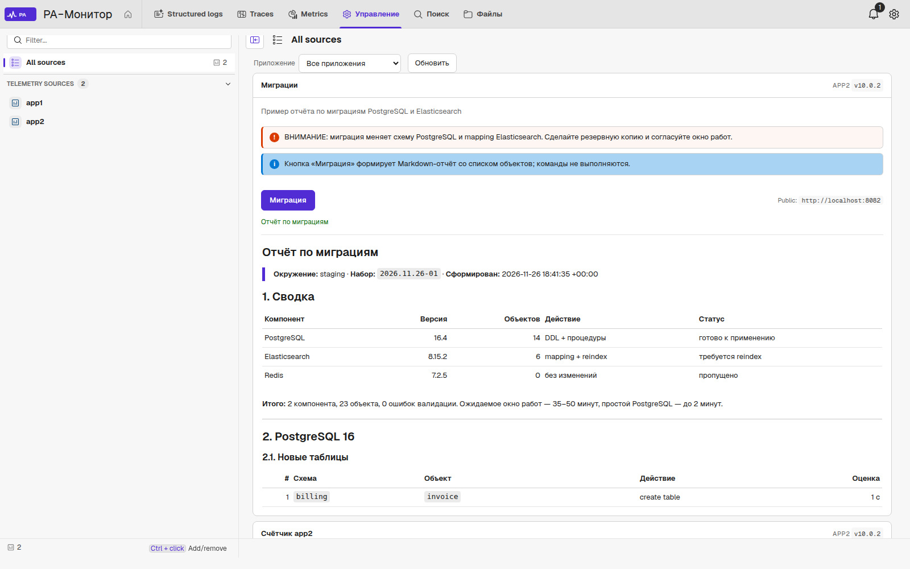

Что показывает отчёт:

- сводку по компонентам и количество объектов;
- PostgreSQL: таблицы, индексы, процедуры, функции, триггеры, view, права;
- Elasticsearch: index template, mapping, анализатор, alias/reindex, ILM;
- порядок выполнения, проверки, риски и команды отката.

---

## 2. Экран «Управление» — счётчик app2

Панель **«Счётчик app2»** управляет живым сервисом: шаг, флаг активности,
read-only значение. Кнопки «Применить», «Сбросить» (с подтверждением) и
«Отчёт (MD)».

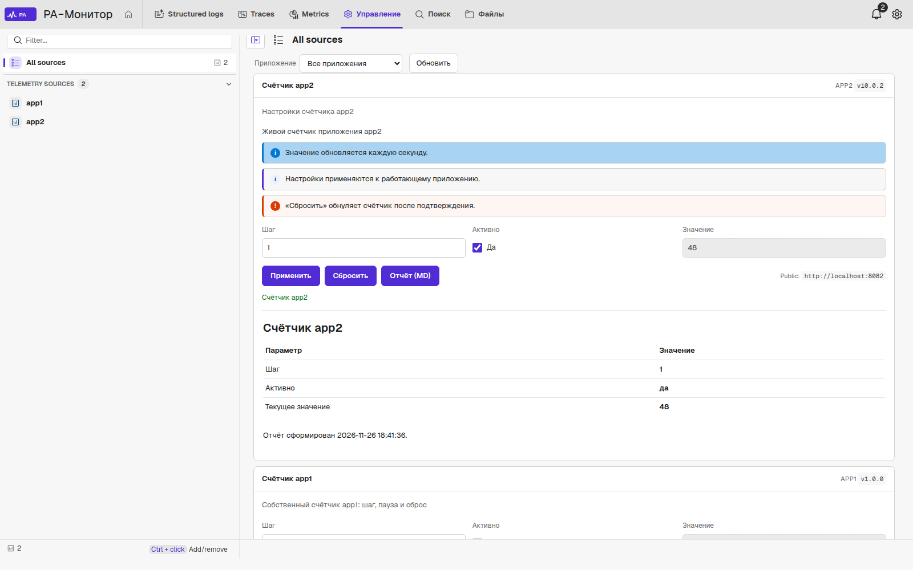

Результат действия показывается в стандартном viewer под панелью. Тот же
Markdown можно открыть из уведомления.

---

## 3. Экран «Поиск» — накладная № 222

Ссылка сразу открывает форму с заполненным номером:

```text
http://localhost:18888/search?filter=app2%2FInvoiceSearchPanel&Number=222
```

После нажатия «Найти» появляется карточка ответа: время, длительность,
параметры запроса и Markdown-viewer с накладной.

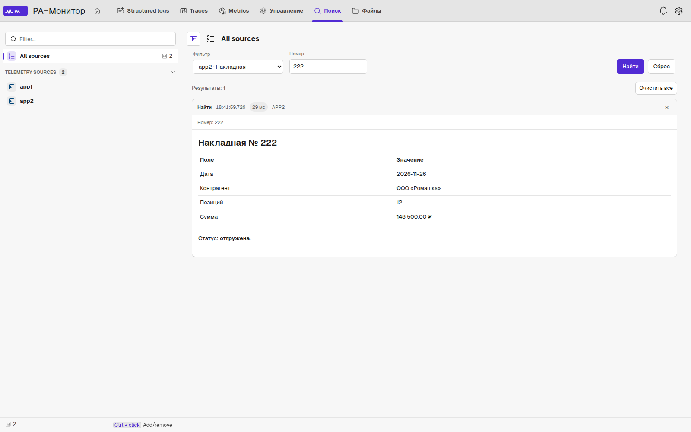

Фильтр, поля и значения хранятся в URL. «Назад» возвращает предыдущее
состояние формы из истории браузера.

---

## 4. Экран «Поиск» — звонки

Фильтр **«Звонки»**: поиск по части номера телефона. Enter в поле запускает
поиск. Новые ответы встают сверху, старые сдвигаются вниз.

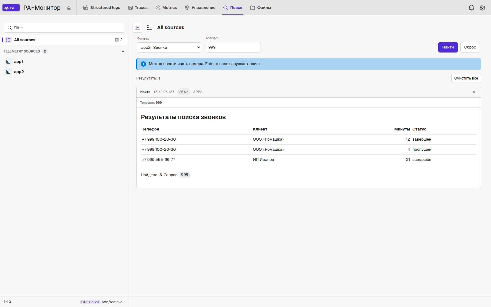

---

## 5. Экран «Файлы» — список Share

Вкладка **«Файлы»** — один браузер с выбором корня в combo. Корень `share`
указывает на `/host-home` — домашнюю директорию хоста, примонтированную
**read-only**. В списке видны папки и файлы, размер, тип, дата и действия
«скачать»/«просмотр».

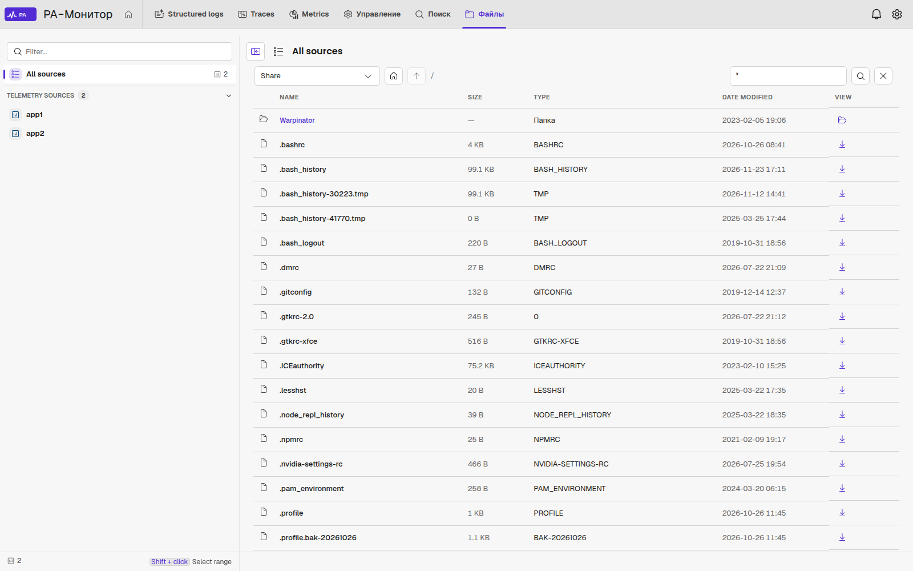

---

## 6. Экран «Файлы» — просмотр

Просмотр файла из Share: `dotnet-install.sh` открывается в текстовом viewer
прямо из домашней директории хоста. Файл не копируется — браузер читает его
через `Dashboard:Files:Roots` и отдаёт в UI. Пока идёт чтение, в preview
показывается спиннер «Чтение файла…».

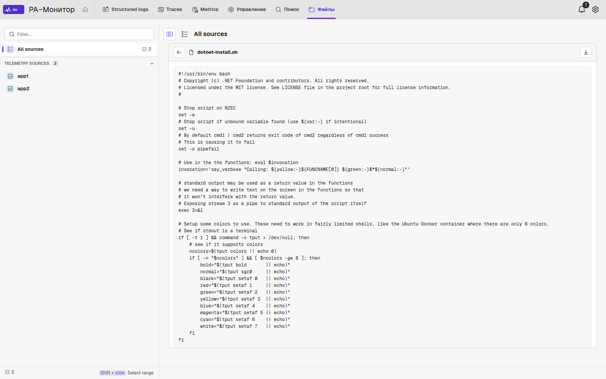

---

## 7. Экран «Файлы» — Markdown

Файлы `.md` открываются в Markdown-viewer. Это тот же компонент, который
используется в «Управлении», «Поиске» и уведомлениях.

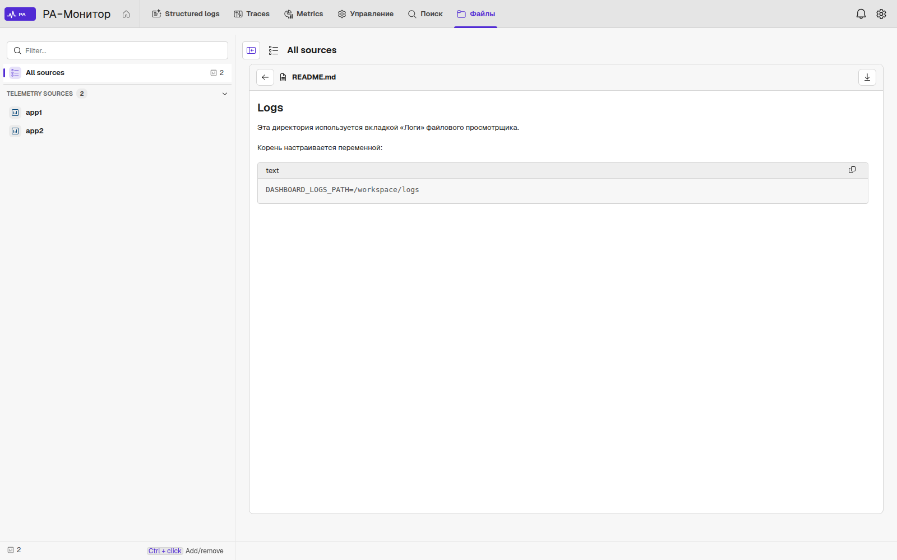

---

## 8. Центр уведомлений

Каждое действие панели создаёт краткое событие: источник, панель, действие,
время. Клик по событию открывает полный ответ, кнопка «Назад» возвращает к
списку.

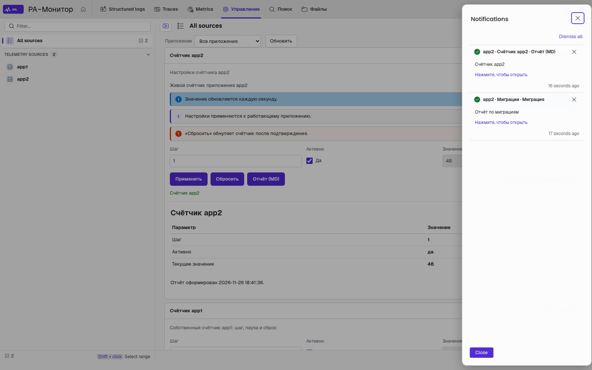

---

## 9. Остальные экраны телеметрии

### Structured logs

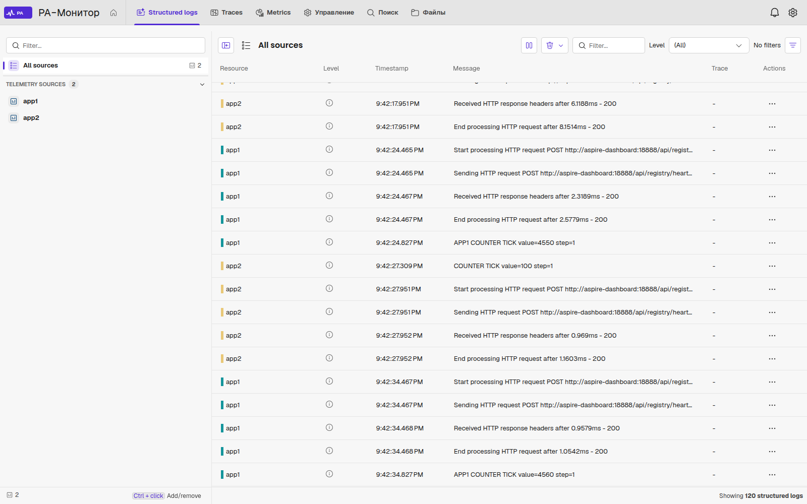

Логи app1/app2, полученные по OTLP/gRPC. Поддерживаются фильтры, раскрытие
записи и переход к ресурсу.

### Traces

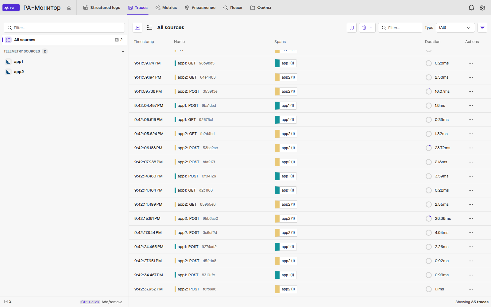

Трейсы запросов и фоновых операций. Клик по трейсу открывает диаграмму
span-ов и детали.

### Metrics

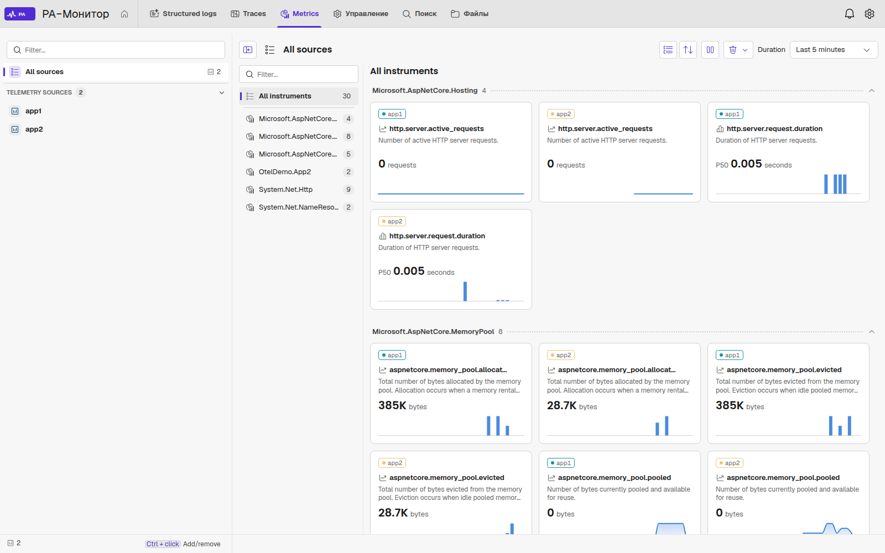

Метрики приложений: счётчики, гистограммы, графики. Можно закрепить
инструмент и смотреть несколько ресурсов.

### Resources

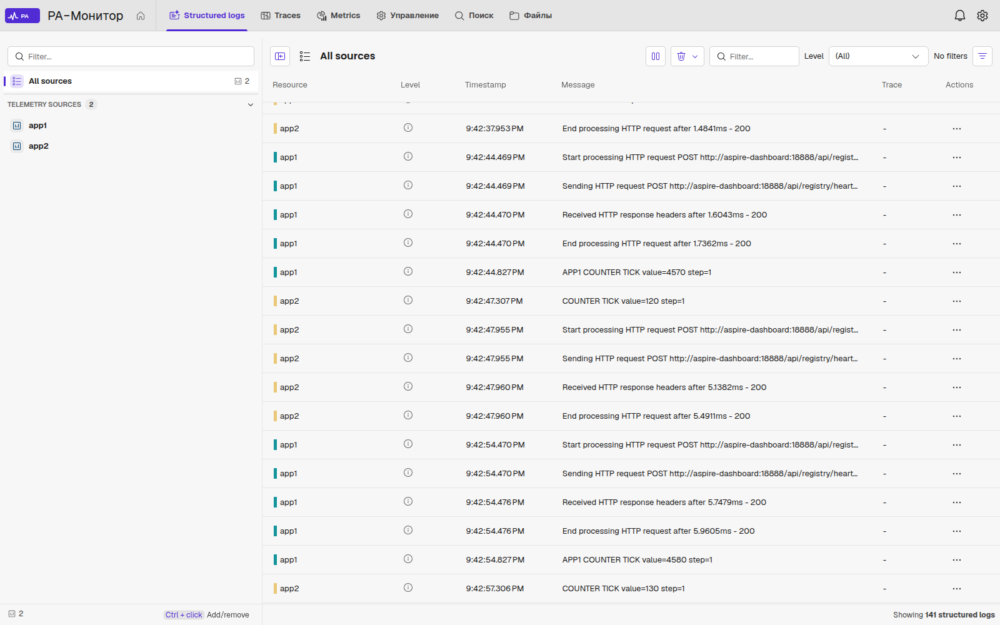

Ресурсы app1/app2/otlp-js-test и их состояние. Клик по ресурсу фильтрует
панели «Управления» по имени источника.

---

## 10. Как это устроено

```text
app1/app2     ── OTLP/gRPC ──→ aspire-dashboard:18889
otlp-js-test  ── OTLP/HTTP ──→ aspire-dashboard:18890
                                │
                                ▼
                       http://localhost:18888

app1/app2/otlp-js-test ── POST /api/registry/register ──→ dashboard
                      ── heartbeat каждые 10 сек ───────→ dashboard

dashboard ── GET  {source}/dashboard/panels ───────────→ app
dashboard ── GET  {source}/dashboard/panels/{id} ──────→ app (auto-refresh)
dashboard ── POST {source}/dashboard/panels/{id}/actions/{action} → app
```

- dashboard — библиотека + web-хост, настройки в DI;
- панели приложений — `RaMonitor.Panels` (`AddDashboardPanels`);
- поисковые панели — `SearchPanel<T>` и `kind: "search"`;
- контент — `DashboardContent { content, type }` и общий `ContentViewer`;
- файлы — один tab «Файлы» с DI-корнями;
- уведомления — события с открытием viewer-а по клику.

---

## 11. Запуск

```bash
docker compose up -d --build
```

Открыть: [http://localhost:18888](http://localhost:18888)

Основные разделы:

| Адрес | Экран |
|---|---|
| `/structuredlogs` | логи |
| `/traces` | трейсы |
| `/metrics` | метрики |
| `/management` | панели приложений |
| `/search` | поисковые фильтры |
| `/files/logs` | файловый браузер логов |

---

*Презентация демонстрационная: отчёт по миграциям — заглушка с примерами
DDL/DSL, команды не выполняются.*
