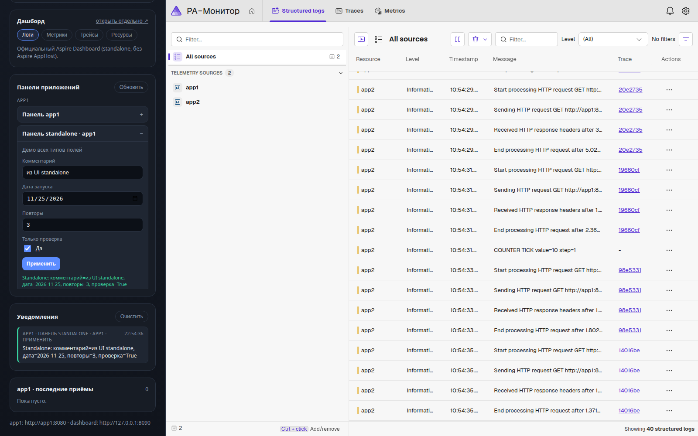

# РА-Монитор Standalone

Отдельная версия проекта: **standalone Aspire Dashboard без AppHost и без Aspire orchestration**. Дашборд собирается из исходников Aspire 17 (вкладка **«Управление»** после Metrics), панели из `Dashboard.Client` подключаются и работают так же, как в основной версии.

## Чем отличается от основной версии

| | Основная версия (`../compose.yaml`) | Эта версия (`standalone/compose.yaml`) |
|---|---|---|
| Aspire Dashboard | custom image 17 + «Управление» | custom image 17 + «Управление» |
| AppHost | опционально, для нативной кнопки | **нет** |
| Панели Dashboard.Client | да | да |
| Своя UI-панель + iframe | да | да |
| Порты по умолчанию | 8080 / 18888 / 4317 | **8090 / 18988 / 4327** |
| Общие исходники | `../src` | `../src` |

Код приложений не копируется: версия отличается только compose-файлом, `.env` и решением без AppHost. Поэтому панели, атрибуты и API полностью совпадают.

## Запуск

```bash
cd standalone
docker compose up -d --build
```

Открыть:

| Адрес | Что это |
|---|---|
| **http://localhost:8090/control** | панель + встроенный Aspire Dashboard |
| http://localhost:8090/management | **Управление: панели приложений с фильтром по app** |
| http://localhost:8090/logs | файловый браузер: логи |
| http://localhost:8090/share | файловый браузер: Share |
| http://localhost:8090/structuredlogs | логи |
| http://localhost:8090/metrics | метрики |
| http://localhost:8090/traces | трейсы |
| http://localhost:18988 | дашборд напрямую |
| http://localhost:8091 | app1 |
| http://localhost:8092 | app2 |
| http://localhost:4327 | OTLP/gRPC |

Остановить:

```bash
cd standalone
docker compose down
```

Порты специально отличаются от основной версии, чтобы обе версии можно было запустить одновременно:

```bash
# терминал 1 — основная
docker compose up -d

# терминал 2 — standalone
cd standalone && docker compose up -d
```

## Управление в дашборде

В шапке дашборда после **Metrics** есть вкладка **«Управление»**, а после неё — опциональные **«Логи»** и **«Share»**. Страница управления рендерится внутри `resource-content`, как Traces/Metrics.

На странице:

- панели из `GET /app2/api/panels`;
- фильтр **«Приложение»**: все / app1 / app2;
- клик по app в левом списке ресурсов → `/management/resource/{app}` и фильтр по нему;
- в заголовке панели — версия app из assembly, например `Панель app1 v1.0.0`;
- text/date/int/bool;
- «Применить» и уведомления;
- фильтр сохраняется в URL: `?app=app1`.

Дашборд собирается из `../dashboard/Dockerfile` на основе Aspire `v17.0.0`. Приложения остаются на .NET 10; .NET 11 используется только внутри сборки дашборда.

## Файловый браузер

Вкладки **«Логи»** и **«Share»** появляются после «Управления», если заданы пути:

```yaml
Dashboard__Files__Logs__Path: /workspace/logs
Dashboard__Files__Share__Path: /workspace/share
```

В standalone проект монтируется read-only:

```yaml
volumes:
  - ..:/workspace:ro
```

Возможности: маски файлов, папки выше файлов, скачивание, полноэкранный preview UTF-8 до 5 МБ, подсветка JSON/YAML, вход в папки, «Вверх», «В корень», клавиша `Home`. Share показывает домашнюю директорию хоста (`/host-home`).

## Панели

Панели:

- `app1` → `Панель app1`: `Name`, `BirthDate`, `Count`, `Enabled` + «Применить»;
- `app1` → `Панель standalone · app1`: `Комментарий`, `Дата запуска`, `Повторы`, `Только проверка` + «Применить» (регистрируется только при `Standalone:Enabled=true`);
- `app2` → `Панель app2`: `Step`, `Enabled` + «Применить».

`Панель standalone · app1` — дополнительный пример для этой версии: показывает все поддерживаемые типы полей (`text`, `date`, `int`, `bool`) и возвращает `Task<string>`, который попадает в колокольчик Aspire Dashboard.

Проверка:

```bash
# Панели конкретного app
curl -s http://localhost:8091/dashboard/panels | python3 -m json.tool
curl -s http://localhost:8092/dashboard/panels | python3 -m json.tool

# Агрегированные панели для Dashboard UI
curl -s http://localhost:8092/api/panels | python3 -m json.tool

# Применить панель app1 через dashboard-хост
curl -s -X POST http://localhost:8090/app2/api/panels/app1/App1DemoPanel/actions/Apply \
  -H 'Content-Type: application/json' \
  -d '{"values":{"Name":"Standalone","BirthDate":"2001-02-03","Count":5,"Enabled":true}}'
```

Ожидаемо:

```json
{
  "success": true,
  "message": "Принято: имя=Standalone, дата=2001-02-03, количество=5, активно=True"
}
```

Результат также появится в колокольчике Aspire Dashboard.

## Метрики и логи

Приложения отправляют OTLP на внутренний адрес:

```text
app1/app2 → http://aspire-dashboard:18889
```

Проверка:

```bash
curl -s http://localhost:18988/api/telemetry/resources | python3 -m json.tool
curl -s 'http://localhost:18988/api/telemetry/logs?limit=20' | python3 -m json.tool | head -40
docker compose logs app1 | grep "MESSAGE RECEIVED"
```

В дашборде:

- **Metrics** → источник `app2` → `OtelDemo.App2` → `app2.counter.value`;
- **Structured logs** → `COUNTER TICK`, `SENT TO APP1`, `MESSAGE RECEIVED`, `PANEL APPLIED`;
- **Traces** → `app2 → app1` запросы.

## Как переехать с AppHost-версии на standalone

1. Не запускайте `src/AppHost` / `dotnet run --project src/AppHost`.
2. Оставьте приложения как есть: им нужны только OTLP endpoint и `Dashboard.Client`.
3. Поднимите standalone-дашборд:

   ```bash
   docker compose -f standalone/compose.yaml --env-file standalone/.env up -d --build
   ```

4. Панели продолжают работать через `/dashboard/panels` и `POST .../actions/...`.
5. Нативные resource commands из AppHost в standalone-дашборде недоступны. Вместо них используйте:
   - кнопки `[DashboardAction]` в панелях;
   - колокольчик «Уведомления»; 
   - HTTP API панелей.

Если позже снова понадобится нативная кнопка в официальном дашборде, вернитесь к основной версии и запустите AppHost.

## Конфигурация

`.env`:

```dotenv
COMPOSE_PROJECT_NAME=otel-demo-standalone
BIND_ADDR=127.0.0.1

GATEWAY_PORT=8090
DASHBOARD_PORT=18988
OTLP_PORT=4327
APP1_PORT=8091
APP2_PORT=8092

DASHBOARD_APP_NAME=РА-Монитор
DASHBOARD_SUPPRESS_UNSECURED=true

ASPIRE_DASHBOARD_IMAGE=mcr.microsoft.com/aspire/dashboard:17.0.0
```

Дополнительные источники панелей:

```yaml
Dashboard__Sources__0__Name: app1
Dashboard__Sources__0__Url: http://app1:8080
```

Дополнительная панель app1:

```yaml
Standalone__Enabled: "true"
```

Если убрать эту переменную, останется только базовая `Панель app1`.

Свои панели app2 добавляет в `GET /api/panels` автоматически.

## Сборка решения без AppHost

```bash
dotnet build standalone/OtelDemo.Standalone.slnx -c Release
```

В решении только:

- `Dashboard.Client`;
- `App1.Api`;
- `App2.Counter`.

AppHost намеренно отсутствует.

## Безопасность

Как и в основной версии, это шаг 1:

- все порты только на `127.0.0.1`;
- дашборд без логина;
- OTLP и API без ключей;
- панели могут менять состояние приложений.

Для production включите auth на gateway/дашборде, закройте `/dashboard/*` и `/api/panels/*`, добавьте HTTPS. Подробнее — в основном `../README.md`, раздел «Безопасность».

## Отличия в UI

UI тот же: `src/App2.Counter/wwwroot/index.html`. Встроенный дашборд через nginx, свои панели, уведомления, скрытые welcome/Help-баннеры.


